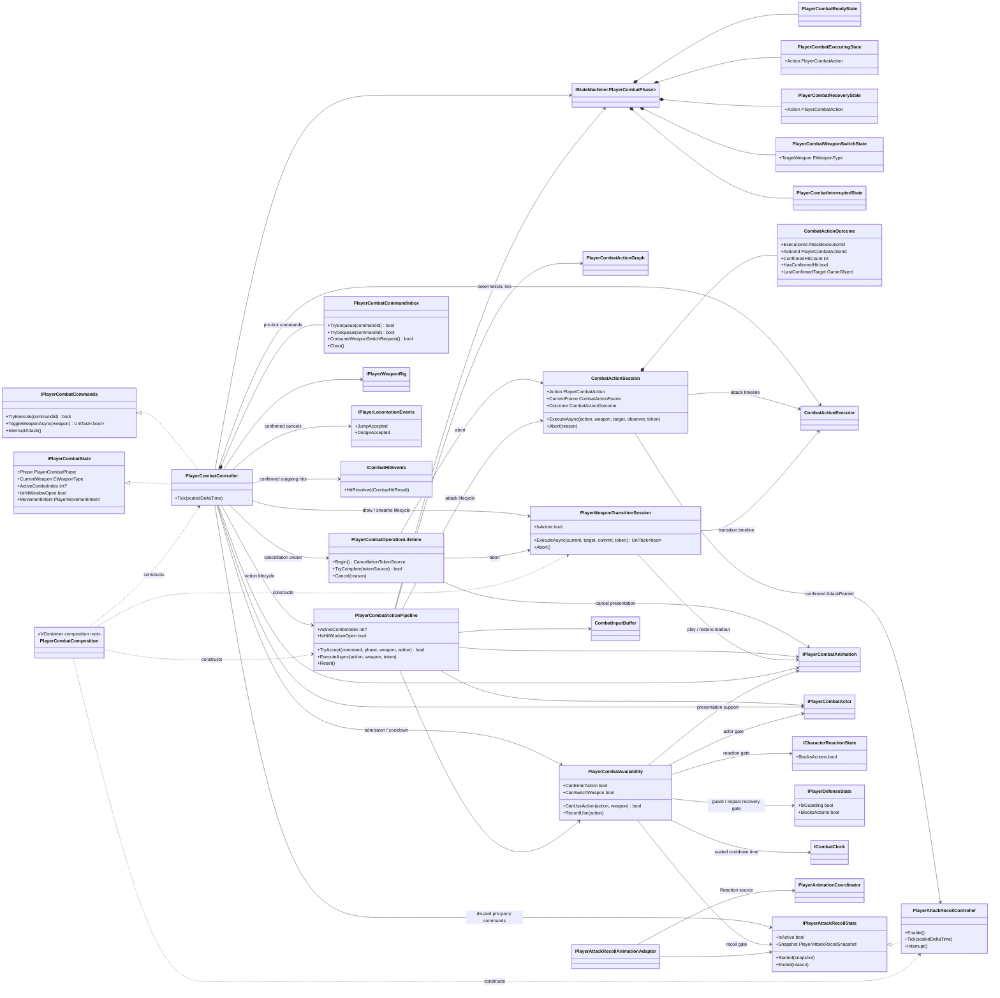
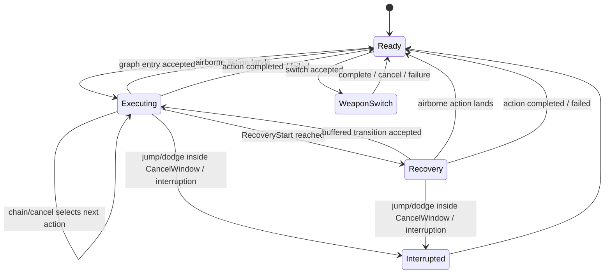

# Project S — Player Combat Runtime

## Ответственность

`PlayerCombatController` принимает семантические команды, владеет subscriptions, operation lifecycle и persistent weapon state. `PlayerCombatActionPipeline` выполняет уже определённые combat actions: обращается к action graph, потребляет contextual input buffer, ведёт action chain и публикует combo/hit-window state. `PlayerCombatCommandInbox` изолирует pre-tick FIFO, `PlayerCombatOperationLifetime` — cancellation ownership attack/weapon операций, `PlayerAttackRecoilController` — потерю управления источником после подтверждённого парирования, а `PlayerCombatAvailability` отвечает за live admission rules и cooldown history. Animator и weapon rig остаются presentation/scene adapters.

Публичные read-events изолированы от gameplay transaction: исключение одного
presentation/UI subscriber логируется отдельно, не блокирует остальных
подписчиков и не может сорвать weapon commit, phase transition либо закрытие
hit window.

Подробная граница admission/cooldown описана в
`Docs/Architecture/Combat.ActionAvailability.md`.

Combat не управляет motor напрямую. Он выдаёт только `PlayerMovementIntent`, который читает locomotion.

## Текущие combo branches

### Ground

Одна команда `attack.light` входит в `combo.ground.0`. Следующие команды сначала
попадают в `CombatInputBuffer` и могут перейти только `0 → 1 → 2` внутри
`ChainWindow` текущего action. После третьего action chain transition отсутствует:
новая цепочка начинается только отдельным вводом, который остаётся жив на
completion boundary.

После первого light action timing самого второго нажатия разделяет две ветки:
rapid input до `0.63` идёт в `combo.ground.1`, а input после осознанной паузы в
`0.67–0.86` запускает `combo.ground.pause-finisher`. Buffer хранит normalized
time получения команды, поэтому заранее намэшенный Light не превращается в
pause-finisher только из-за позднего consumption.

| Step | Duration | Hitbox | Chain | Cancel | Damage | Motor distance |
| ---: | ---: | ---: | ---: | ---: | ---: | ---: |
| 0 | 1.267 s | 0.27–0.46 | 0.46–0.72 | 0.46–0.86 | 10 | 0.55 m |
| 1 | 1.000 s | 0.18–0.38 | 0.38–0.66 | 0.38–0.84 | 12 | 0.75 m |
| 2 | 1.067 s | 0.16–0.34 | disabled | 0.52–0.86 | 15 | 0.70 m |

`attack.heavy` не является четвёртым combo step. Это самостоятельная наземная
action с duration `1.933 s`, hitbox `0.40–0.58`, damage `24` и motor distance
`0.90 m`; она отображается через существующий `BaseAttack4` slot.
`combo.ground.pause-finisher` является отдельным graph node без entry rule, но
на текущем vertical slice переиспользует тот же presentation/timeline, чтобы не
менять универсальный Animator до выбора отдельного клипа.

На первых двух light steps `CancelWindow` начинается одновременно с
`ChainWindow`. Поэтому, если light и named action уже находятся в buffer,
настроенный priority выбирает осознанный heavy/special вместо автоматического
перехода к следующему light step. Окончание окон остаётся независимым.

Это стартовые tuning values для текущего набора клипов. Damage/hitbox/movement
остаются gameplay data и не вычисляются из Animator. Presentation получает лишь
ожидаемую длительность action и подстраивает скорость активного override-клипа.

### Launcher и air chase

Кнопка `1 / LB` публикует `attack.launcher`. В активном Dual Swords moveset это
самостоятельный grounded entry, а также hit-confirm cancel из каждого шага
`combo.ground.0/1/2`. Unarmed profile сохраняет более строгий вариант без entry
и разрешает launcher только после попадания первых двух light steps. Сам launcher
наносит `14` damage,
передаёт цели горизонтальную скорость `0.35 m/s` и отдельную вертикальную
скорость `6.5 m/s`. Target-local reaction немедленно входит в `Airborne`.

Повторный `attack.light` в chain window попавшего launcher запускает
`movement.air-chase`. Action поднимает игрока одноразовым motor impulse
`6.2 m/s`, движется к actor root именно последней подтверждённой цели и не
подменяет lock-on. Во время bounded motion window chase измеряет фактическое
вертикальное движение цели, держит игрока на `0.15 m` ниже и ограничивает
коррекцию скоростью `8 m/s`. Ещё один `attack.light` внутри chase переводит граф
в `combo.air.0`; launcher target переносится через безударный chase и остаётся
приоритетной motion-целью air combo. При отсутствии ввода chase завершается
обычным airborne locomotion. Промах на любом hit-confirm этапе не открывает
следующий переход.

### Air

Во время `Falling` та же команда `attack.light` входит в `combo.air.0` и может
продолжиться только `0 → 1 → 2`. Воздушный finisher завершает цепочку.

| Step | Duration | Hitbox | Chain | Cancel | Damage | Motor distance |
| ---: | ---: | ---: | ---: | ---: | ---: | ---: |
| 0 | 1.583 s | 0.12–0.31 | 0.32–0.46 | 0.50–0.84 | 10 | 0.35 m |
| 1 | 1.500 s | 0.10–0.32 | 0.33–0.46 | 0.50–0.84 | 12 | 0.35 m |
| 2 | 1.917 s | 0.11–0.35 | disabled | 0.62–0.90 | 22 | 0.45 m |

Начало chain windows выбрано по измеренному pose seam retargeted clips, а не по
произвольному общему значению. Steps `0` и `1` используют
`MinimumVelocity(-1.5 m/s)` для ограниченного air hang до `0.58` normalized
time. Finisher `combo.air.2` вместо hang задаёт контролируемый dive игрока
`OverrideVelocity(-9 m/s)` и цели signed impact `VerticalKnockback(-12 m/s)`.
Его planar knockback ограничен `0.35 m/s`, поэтому цель вбивается вниз, а не
вылетает из contact pair. После подтверждённого приземления цель проходит
`Airborne → Knockdown → GetUp`; приземление игрока завершает airborne action и
возвращает locomotion authority. Planar и vertical displacement по-прежнему
исполняет motor; Animator root motion отключён.

## Дерево классов и зависимости



## State machine



`IStateMachine<PlayerCombatPhase>` — единственный owner combat phase. Controller больше не хранит собственный mutable phase и не содержит отдельный ручной `CanChangePhase`. `ExecutingState` и `RecoveryState` получают текущий `PlayerCombatAction` как context, а `WeaponSwitchState` — целевое оружие.

`RecoveryStart` является частью gameplay timeline, а не animation event. Поэтому transition в recovery остаётся определённым даже при смене Animator Controller или клипа.

Парирование атаки не добавляет искусственный `ParryStagger` в эту state machine.
`CombatActionSession` завершает action с причиной `Parried`, после чего combat phase
возвращается в `Ready`, а независимый `PlayerAttackRecoilController` ещё `0.55 s`
блокирует action admission и movement intent. Благодаря этому combat phase не
дублирует reaction state, но публичный `Ready` не открывает управление раньше
окончания наказания.

## Выполнение action

```mermaid
sequenceDiagram
    participant Input as IPlayerInput
    participant Actor as PlayerActorController
    participant Combat as PlayerCombatController
    participant Pipeline as PlayerCombatActionPipeline
    participant Graph as PlayerCombatActionGraph
    participant Machine as Combat StateMachine
    participant Session as CombatActionSession
    participant Executor as CombatActionExecutor
    participant Hits as ICombatHitEvents
    participant View as Animation / Weapon adapters

    Input->>Combat: CombatActionRequested(command) / latch
    Actor->>Combat: Tick(scaledDeltaTime)
    Combat->>Executor: Advance(scaledDeltaTime)
    Combat->>Pipeline: TryAccept(command, phase, weapon)
    Pipeline->>Graph: TryResolveEntry(command, environment)
    Graph-->>Pipeline: PlayerCombatAction
    Combat->>Pipeline: ExecuteAsync(action, weapon, token)
    Pipeline->>View: TryPlayAction(character, weapon, action)
    Pipeline->>Machine: Ready -> Executing(action)
    Pipeline->>Session: ExecuteAsync(action)
    Session->>Executor: ExecuteAsync(definition)
    Hits-->>Combat: HitResolved(matching execution)
    Combat->>Pipeline: TryRecord(hit)
    Pipeline->>Session: TryRecord(hit)
    Combat->>Executor: Observe()
    Executor-->>Session: CombatActionFrame
    Session-->>Pipeline: frame + active outcome
    Pipeline->>Machine: Executing -> Recovery(action)
    Pipeline->>Graph: resolve buffered transition
    Pipeline->>Machine: Recovery -> Executing(next action)
```

Сначала buffered command проверяется как transition текущего action. Если его
окно не открылось, но команда не истекла к завершению timeline, pipeline
проверяет её как новый graph entry в актуальном environment. Так recovery input
не теряется, при этом недопустимый ground/air action и cooldown по-прежнему
отсекаются gameplay graph до запуска presentation.

Каждый transition может дополнительно требовать `Any`, `OnHit` или `OnWhiff`.
`OnHit` читает только подтверждённый `CombatHitResult` текущих execution/action ids.
`OnWhiff` становится определённым лишь после закрытия hitbox-window, поэтому ранний
buffered input не может принять отсутствие ещё не завершившегося попадания за промах.
Обычные combo/cancel routes используют `Any`, а переходы из ground-light actions
в `attack.launcher` требуют `OnHit`. В Unarmed profile это первые два шага и
отдельного launcher entry нет. Dual Swords добавляет третий hit-confirm cancel и
самостоятельный grounded entry той же команды. Поэтому промах light action не
может воспользоваться cancel route, но прямой Dual Swords launcher остаётся
доступным из `Ready` как отдельное правило графа.

Для ground/air combo `PlayerCombatController` передаёт adapter целую
`PlayerCombatAction`. `PlayerCombatAnimationAdapter` в одном месте преобразует
её presentation в semantic track, presentation `ComboIndex` и
`CombatActionDefinition.DurationSeconds`. Это не переносит authority в Animator:
длительность остаётся метаданными ожидаемого playback. Текущий XController
воспроизводит authored clip speed и не выводит gameplay timeline из normalized
time Animator.

Для named presentation тот же adapter читает `PlayerCombatAnimationId` из action
и использует ожидаемую gameplay-длительность. Наземный `attack.heavy` отображается
существующим `Attack/BaseAttack4`, а `skill.special` — `Attack/Skill`. ПКМ/RT
выдают semantic command тяжёлой атаки; клавиша `3`/D-pad Down — special,
независимо от control scheme.

`CanPlayAction` проверяет только существование поддерживаемого presentation slot.
Допустимость action по environment, cooldown, reaction state и graph transition
остаётся в gameplay pipeline/graph. Поэтому animation adapter не становится
владельцем combat rules.

Hitbox открывается только по `CombatActionFrame` и закрывается при completion,
cancellation, interruption и disable. `CombatActionSession` является единым
owner текущей action, `CombatAttackExecution`, `CombatActionOutcome` и hitbox
window. Каждое фактически запущенное action получает отдельный execution,
поэтому повторные hurtbox одной цели фильтруются на уровне атаки, а не оружия.
Подтверждённая motion-цель копируется в result до очистки session. Weapon rig и
`CurrentWeapon` меняются только в commit point; Animator loadout может быть
временно переключён перед draw и восстанавливается до последнего подтверждённого
оружия при cancellation/failure. Этой последовательностью владеет
`PlayerWeaponTransitionSession`, поэтому controller больше не является timeline
observer смены оружия. Cooldown хранится по
`PlayerCombatActionId`; animation lookup использует отдельный
`PlayerCombatAnimationId`. Подробная граница описана в
`Docs/Architecture/Combat.ActionSession.md` и
`Docs/Architecture/Combat.WeaponTransition.md`.

Gameplay timeline использует scaled delta time, поэтому execution, hitbox/cancel windows, обычный Animator и character physics замораживаются во время hit stop. Input buffer намеренно использует unscaled clock: команды продолжают приниматься и истекают в реальном времени. Полная time policy описана в `Docs/Architecture/Combat.HitStop.md`.

Timeline не содержит собственного async frame loop. Каждый actor tick сначала
вызывает `CombatActionExecutor.Advance`, затем controller потребляет защёлкнутые
semantic commands относительно нового `CurrentFrame` и после этого вызывает
`Observe`. `ExecuteAsync` остаётся lifecycle-result API для action/weapon
sequences, но его continuation не является источником времени. Это даёт один
детерминированный owner порядка frame boundaries, input windows и completion.

`IPlayerCombatState.ActiveComboIndex` отделяет отсутствие активной combo action
(`null`) от первого authored шага (`0`). Значение меняется при входе в каждый
ground/air combo step и возвращается в `null` при named action, completion,
interruption и disable. Поэтому UI/debug consumers не выводят active combo из
неоднозначной пары `Phase + 0`.

`Allow Jump / Allow Dodge / Allow Guard` в action profile не открывают cancel на
всей длительности атаки. `CombatActionExecutor` совмещает эти policies с текущим
`CancelWindow` и только затем публикует соответствующие разрешения. Locomotion
остаётся владельцем jump/dodge, а `PlayerDefenseController` — guard entry. После
подтверждённого dodge/jump либо допустимого `GuardStarted` combat закрывает
hitbox, motion, outcome и animation action через обычную interruption boundary.
Неудачная попытка или ввод до окна action не отменяют.
Подтверждённые locomotion cancels освобождают Combat animation ownership без
промежуточного `Move`; dodge/jump presentation получает прямой handoff.

## Lifecycle

- `Enable` запускает state machine в `Ready` и симметрично подписывает semantic input, dodge, state и outgoing hit events.
- `Disable` через `PlayerCombatOperationLifetime` отменяет UniTask action,
  передаёт session причину `Disabled`, очищает
  buffer, закрывает hitbox, снимает callbacks и останавливает state machine.
- Ошибка во время запуска action откатывает частично начатый execution через тот
  же `Abort` boundary: damage-immunity lease освобождается, combat motion
  очищается, а executor снова допускает следующее действие.
- Отмена weapon transition прерывает общий executor, сохраняет только оружие,
  которое уже пересекло commit frame, и возвращает Animator к соответствующему
  loadout. Незавершённый draw не меняет `CurrentWeapon` и weapon rig.
- Airborne-only action проверяет актуальный environment на каждом frame timeline.
  Приземление имеет приоритет над buffered transition: controller закрывает
  hitbox, завершает motion, отменяет combat presentation и возвращается в
  `Ready`. Action с environment `Any` эту границу не наследует.
- State machine и её states создаются scoped-регистрациями VContainer в `PlayerCombatComposition`; controller не вызывает `Resolve` и не владеет container.
- `PlayerCombatActionProfile` является обязательной serialized-зависимостью
  Player prefab. Composition не создаёт запасной prototype graph: отсутствующая
  ссылка останавливает сборку scope с точным сообщением вместо запуска другого
  moveset.
- `PlayerCombatAvailability` создаётся в том же scope и является единственным
  owner cooldown timestamps. Disable/enable controller не сбрасывает cooldown,
  поэтому время действия ограничений совпадает с lifecycle gameplay scope.
- Animator, graph authoring и input buffer не являются владельцами combat phase.
- Входящая реакция передаёт session причину `Reaction`, defense — `Defense`, а
  подтверждённый jump/dodge — `Locomotion`. Все пути проходят через один session
  cleanup вместо ручного сброса execution/outcome в controller.
- Подтверждённый `Parried` синхронно публикуется владельцу source recoil до
  закрытия session. Старый accepted successor, combat buffer и pre-tick inbox
  очищаются на этой границе, поэтому команда, записанная против прерванной
  атаки, не может продолжить combo. Новый ввод, полученный уже во время recoil,
  разрешено хранить как `Ready` entry и исполнить после снятия gate.
- `PlayerAttackRecoilController` использует scaled delta time: hit stop замораживает
  и наказание, и его presentation. Recoil блокирует attack, weapon switch,
  guard, jump/dodge, traversal и locomotion translation. Подтверждённый damage
  reaction или death прерывает recoil и получает более сильную presentation
  authority.
- `PlayerAttackRecoilAnimationAdapter` переиспользует directional HitStun slot
  через общий `PlayerAnimationCoordinator` с source `Reaction`; отдельный Animator
  и отдельная копия animation state не создаются. Обычное completion выполняет
  короткий authored cancel в locomotion, потому что `XController.HitStun` сам не
  имеет выхода. Входящий damage/death вместо этого только освобождает ownership,
  позволяя следующей реакции сделать прямой переход без промежуточного `Move`.
- Общий operation lifecycle, защита от запоздавшего async `finally` и порядок
  cancellation описаны в `Docs/Architecture/Combat.OperationLifetime.md`.
- Входящая реакция не входит в combat state machine. `PlayerActorController` прерывает executing/recovery/weapon-switch action по подтверждённому reaction state, а `PlayerCombatAvailability` читает только `ICharacterReactionState.BlocksActions`, чтобы не принять новый action во время hit-stun/knockdown/airborne/death. Владельцем этих состояний остаётся `CharacterReactionController`.

`IPlayerCombatActor.CanAttack` допускает только обычные walking/falling movement
modes и по-прежнему блокирует crouch и dodge. Поэтому воздушная ветка доступна
после реального перехода locomotion в `Falling`, а climbing/custom modes не обходят
actor gate.

Guard и подтверждённые block/parry recovery не входят в combat state machine.
Их единственный owner — `PlayerDefenseController`; combat читает только
`IPlayerDefenseState.BlocksActions`. Пока recovery активен, новый action не
стартует, но команда, введённая после отпускания Guard, может жить в shared
unscaled buffer и начать entry в первый доступный тик. Recovery и defense
presentation используют одни и те же authored durations, поэтому Animator не
удерживает персонажа визуально после открытия gameplay admission.
