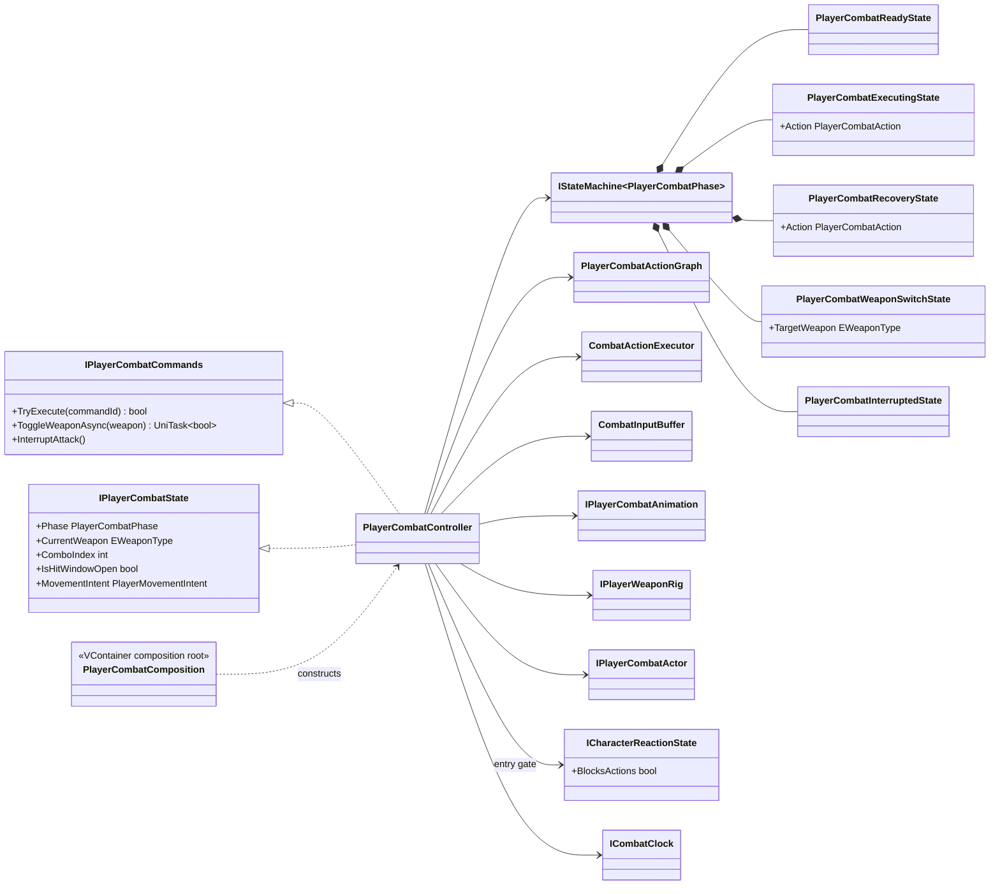
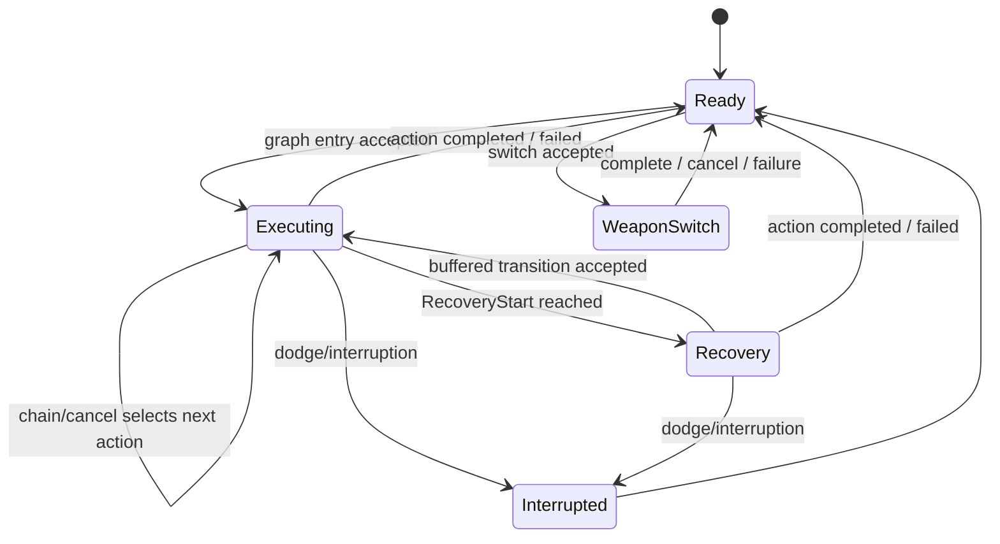
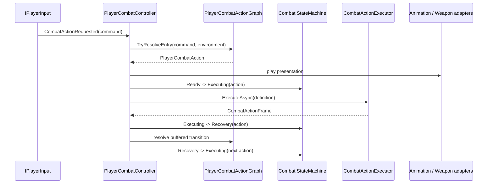

# Project S — Player Combat Runtime

## Ответственность

`PlayerCombatController` координирует выполнение уже определённых combat actions: принимает семантические команды, обращается к action graph, запускает timeline executor, управляет buffer/cooldown и публикует подтверждённое состояние. Animator и weapon rig остаются presentation/scene adapters.

Combat не управляет motor напрямую. Он выдаёт только `PlayerMovementIntent`, который читает locomotion.

## Дерево классов и зависимости

## State machine

`IStateMachine<PlayerCombatPhase>` — единственный owner combat phase. Controller больше не хранит собственный mutable phase и не содержит отдельный ручной `CanChangePhase`. `ExecutingState` и `RecoveryState` получают текущий `PlayerCombatAction` как context, а `WeaponSwitchState` — целевое оружие.

`RecoveryStart` является частью gameplay timeline, а не animation event. Поэтому transition в recovery остаётся определённым даже при смене Animator Controller или клипа.

## Выполнение action

Hitbox открывается только по `CombatActionFrame` и закрывается при completion, cancellation, interruption и disable. Каждое фактически запущенное action получает отдельный `CombatAttackExecution`, поэтому повторные hurtbox одной цели фильтруются на уровне атаки, а не оружия. Weapon transition применяет loadout только после commit point. Cooldown хранится по `PlayerCombatActionId`; animation lookup использует отдельный `PlayerCombatAnimationId`.

Gameplay timeline использует scaled delta time, поэтому execution, hitbox/cancel windows, обычный Animator и character physics замораживаются во время hit stop. Input buffer намеренно использует unscaled clock: команды продолжают приниматься и истекают в реальном времени. Полная time policy описана в `Docs/Architecture/Combat.HitStop.md`.

## Lifecycle

- `Enable` запускает state machine в `Ready` и симметрично подписывает semantic input, dodge и state events.
- `Disable` отменяет UniTask action, aborts executor, очищает buffer, закрывает hitbox, снимает callbacks и останавливает state machine.
- State machine и её states создаются scoped-регистрациями VContainer в `PlayerCombatComposition`; controller не вызывает `Resolve` и не владеет container.
- Animator, graph authoring и input buffer не являются владельцами combat phase.
- Входящая реакция не входит в combat state machine. `PlayerActorController` прерывает executing/recovery/weapon-switch action по подтверждённому reaction state, а `PlayerCombatController` читает только `ICharacterReactionState.BlocksActions`, чтобы не принять новый action во время hit-stun/knockdown/airborne/death. Владельцем этих состояний остаётся `CharacterReactionController`.

Текущий `IPlayerCombatActor.CanAttack` сохраняет проверенное наземное ограничение. Graph уже поддерживает `Grounded/Airborne`, но включение воздушных атак требует отдельного изменения actor gate и реальных air clips, а не скрытого обхода текущей locomotion policy.
