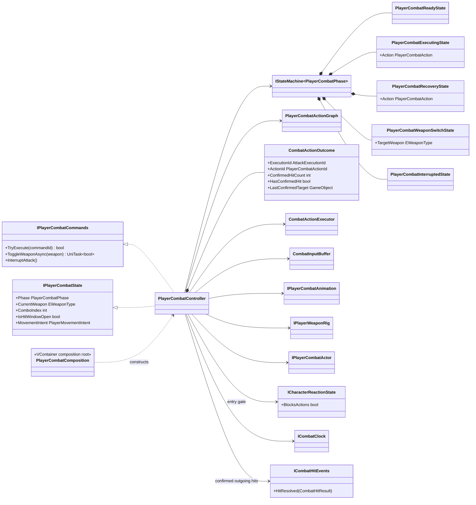
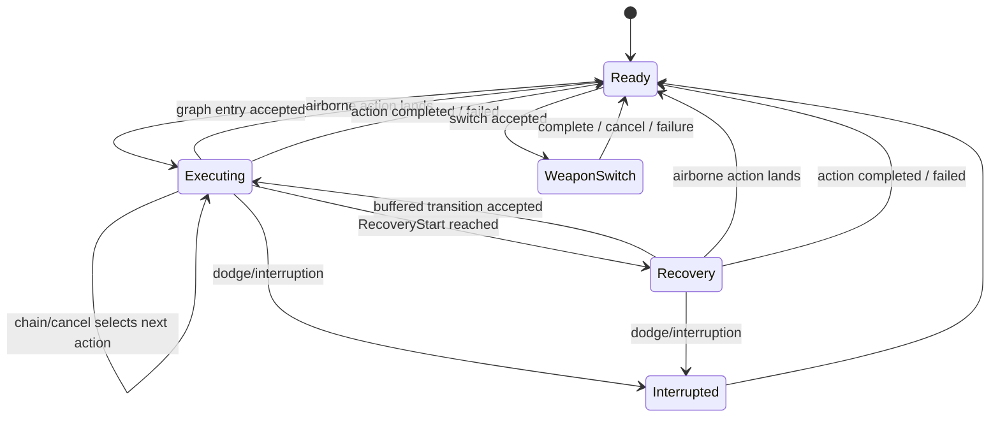
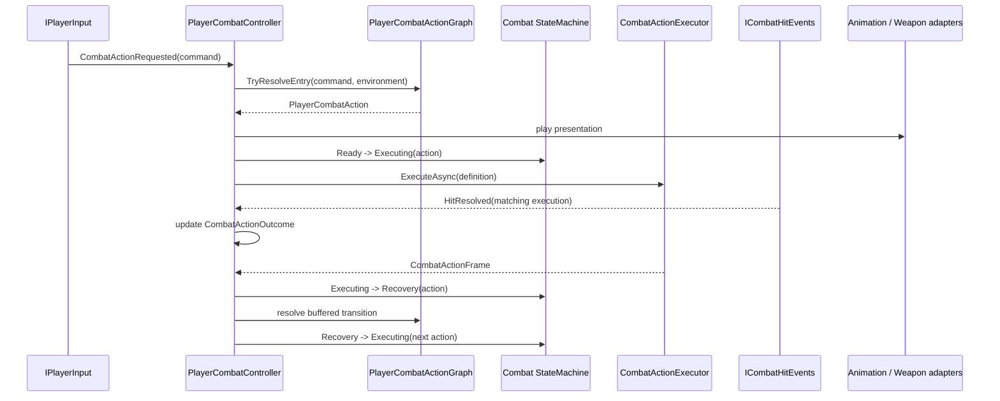

# Project S — Player Combat Runtime

## Ответственность

`PlayerCombatController` координирует выполнение уже определённых combat actions: принимает семантические команды, обращается к action graph, запускает timeline executor, управляет buffer/cooldown и публикует подтверждённое состояние. Animator и weapon rig остаются presentation/scene adapters.

Combat не управляет motor напрямую. Он выдаёт только `PlayerMovementIntent`, который читает locomotion.

## Текущие combo branches

### Ground

Одна команда `attack.light` входит в `combo.ground.0`. Следующие команды сначала
попадают в `CombatInputBuffer` и могут перейти только `0 → 1 → 2` внутри
`ChainWindow` текущего action. После третьего action chain transition отсутствует:
новая цепочка начинается только отдельным вводом, который остаётся жив на
completion boundary.

| Step | Duration | Hitbox | Chain | Cancel | Damage | Motor distance |
| ---: | ---: | ---: | ---: | ---: | ---: | ---: |
| 0 | 1.20 s | 0.28–0.50 | 0.50–0.76 | 0.50–0.90 | 10 | 0.55 m |
| 1 | 1.40 s | 0.30–0.50 | 0.52–0.78 | 0.52–0.90 | 12 | 0.75 m |
| 2 | 1.50 s | 0.35–0.55 | disabled | 0.64–0.92 | 15 | 0.70 m |

`attack.heavy` не является четвёртым combo step. Это самостоятельная наземная
action с duration `1.32 s`, hitbox `0.24–0.45`, damage `24` и motor distance
`0.90 m`; она отображается через существующий `BaseAttack4` slot.

На первых двух light steps `CancelWindow` начинается одновременно с
`ChainWindow`. Поэтому, если light и named action уже находятся в buffer,
настроенный priority выбирает осознанный heavy/special вместо автоматического
перехода к следующему light step. Окончание окон остаётся независимым.

Это стартовые tuning values для текущего набора клипов. Damage/hitbox/movement
остаются gameplay data и не вычисляются из Animator. Presentation получает лишь
ожидаемую длительность action и подстраивает скорость активного override-клипа.

### Launcher и air chase

Кнопка `1 / LB` публикует `attack.launcher`. Это не самостоятельный entry:
launcher доступен только из cancel window `combo.ground.0` или
`combo.ground.1` после подтверждённого попадания. Он наносит `14` damage,
передаёт цели горизонтальную скорость `0.35 m/s` и отдельную вертикальную
скорость `6.5 m/s`. Target-local reaction немедленно входит в `Airborne`.

Повторный `attack.light` в chain window попавшего launcher запускает
`movement.air-chase`. Action поднимает игрока одноразовым motor impulse
`6.2 m/s`, движется к actor root именно последней подтверждённой цели и не
подменяет lock-on. Ещё один `attack.light` внутри chase переводит граф в
`combo.air.0`; при отсутствии ввода chase завершается обычным airborne
locomotion. Промах на любом hit-confirm этапе не открывает следующий переход.

### Air

Во время `Falling` та же команда `attack.light` входит в `combo.air.0` и может
продолжиться только `0 → 1 → 2`. Воздушный finisher завершает цепочку.

| Step | Duration | Hitbox | Chain | Cancel | Damage | Motor distance |
| ---: | ---: | ---: | ---: | ---: | ---: | ---: |
| 0 | 1.583 s | 0.12–0.31 | 0.32–0.46 | 0.50–0.84 | 10 | 0.35 m |
| 1 | 1.500 s | 0.10–0.32 | 0.33–0.46 | 0.50–0.84 | 12 | 0.35 m |
| 2 | 1.917 s | 0.11–0.35 | disabled | 0.62–0.90 | 22 | 0.45 m |

Начало chain windows выбрано по измеренному pose seam retargeted clips, а не по
произвольному общему значению. `MinimumVelocity(-1.5 m/s)` создаёт ограниченный
air hang только до `0.58 / 0.58 / 0.55` normalized time, не выключая gravity на
весь action. Planar и vertical displacement по-прежнему исполняет motor; Animator
root motion отключён.

## Дерево классов и зависимости

## State machine

`IStateMachine<PlayerCombatPhase>` — единственный owner combat phase. Controller больше не хранит собственный mutable phase и не содержит отдельный ручной `CanChangePhase`. `ExecutingState` и `RecoveryState` получают текущий `PlayerCombatAction` как context, а `WeaponSwitchState` — целевое оружие.

`RecoveryStart` является частью gameplay timeline, а не animation event. Поэтому transition в recovery остаётся определённым даже при смене Animator Controller или клипа.

## Выполнение action

Сначала buffered command проверяется как transition текущего action. Если его
окно не открылось, но команда не истекла к завершению timeline, controller
проверяет её как новый graph entry в актуальном environment. Так recovery input
не теряется, при этом недопустимый ground/air action и cooldown по-прежнему
отсекаются gameplay graph до запуска presentation.

Каждый transition может дополнительно требовать `Any`, `OnHit` или `OnWhiff`.
`OnHit` читает только подтверждённый `CombatHitResult` текущих execution/action ids.
`OnWhiff` становится определённым лишь после закрытия hitbox-window, поэтому ранний
buffered input не может принять отсутствие ещё не завершившегося попадания за промах.
Текущий профиль использует `Any`; outcome-условия являются готовой границей для
будущих hit-confirm веток и не меняют существующие combo transitions автоматически.

Для ground/air combo presentation вызов содержит отдельный semantic track,
`ComboIndex` и
`CombatActionDefinition.DurationSeconds`. Это не переносит authority в Animator:
длительность остаётся метаданными ожидаемого playback. Текущий XController
воспроизводит authored clip speed и не выводит gameplay timeline из normalized
time Animator.

Для named presentation controller передаёт отдельный `PlayerCombatAnimationId`
и ту же ожидаемую gameplay-длительность. Наземный `attack.heavy` отображается
существующим `Attack/BaseAttack4`, а `skill.special` — `Attack/Skill`. ПКМ/RT
выдают semantic command тяжёлой атаки; клавиша `3`/D-pad Down — special,
независимо от control scheme.

Hitbox открывается только по `CombatActionFrame` и закрывается при completion, cancellation, interruption и disable. Каждое фактически запущенное action получает отдельный `CombatAttackExecution`, поэтому повторные hurtbox одной цели фильтруются на уровне атаки, а не оружия. Параллельный `CombatActionOutcome` хранит только подтверждённый результат этого execution и сбрасывается на той же lifecycle-границе. Weapon transition применяет loadout только после commit point. Cooldown хранится по `PlayerCombatActionId`; animation lookup использует отдельный `PlayerCombatAnimationId`.

Gameplay timeline использует scaled delta time, поэтому execution, hitbox/cancel windows, обычный Animator и character physics замораживаются во время hit stop. Input buffer намеренно использует unscaled clock: команды продолжают приниматься и истекают в реальном времени. Полная time policy описана в `Docs/Architecture/Combat.HitStop.md`.

## Lifecycle

- `Enable` запускает state machine в `Ready` и симметрично подписывает semantic input, dodge, state и outgoing hit events.
- `Disable` отменяет UniTask action, aborts executor, очищает buffer и outcome, закрывает hitbox, снимает callbacks и останавливает state machine.
- Airborne-only action проверяет актуальный environment на каждом frame timeline.
  Приземление имеет приоритет над buffered transition: controller закрывает
  hitbox, завершает motion, отменяет combat presentation и возвращается в
  `Ready`. Action с environment `Any` эту границу не наследует.
- State machine и её states создаются scoped-регистрациями VContainer в `PlayerCombatComposition`; controller не вызывает `Resolve` и не владеет container.
- Animator, graph authoring и input buffer не являются владельцами combat phase.
- Входящая реакция не входит в combat state machine. `PlayerActorController` прерывает executing/recovery/weapon-switch action по подтверждённому reaction state, а `PlayerCombatController` читает только `ICharacterReactionState.BlocksActions`, чтобы не принять новый action во время hit-stun/knockdown/airborne/death. Владельцем этих состояний остаётся `CharacterReactionController`.

`IPlayerCombatActor.CanAttack` допускает только обычные walking/falling movement
modes и по-прежнему блокирует crouch и dodge. Поэтому воздушная ветка доступна
после реального перехода locomotion в `Falling`, а climbing/custom modes не обходят
actor gate.
