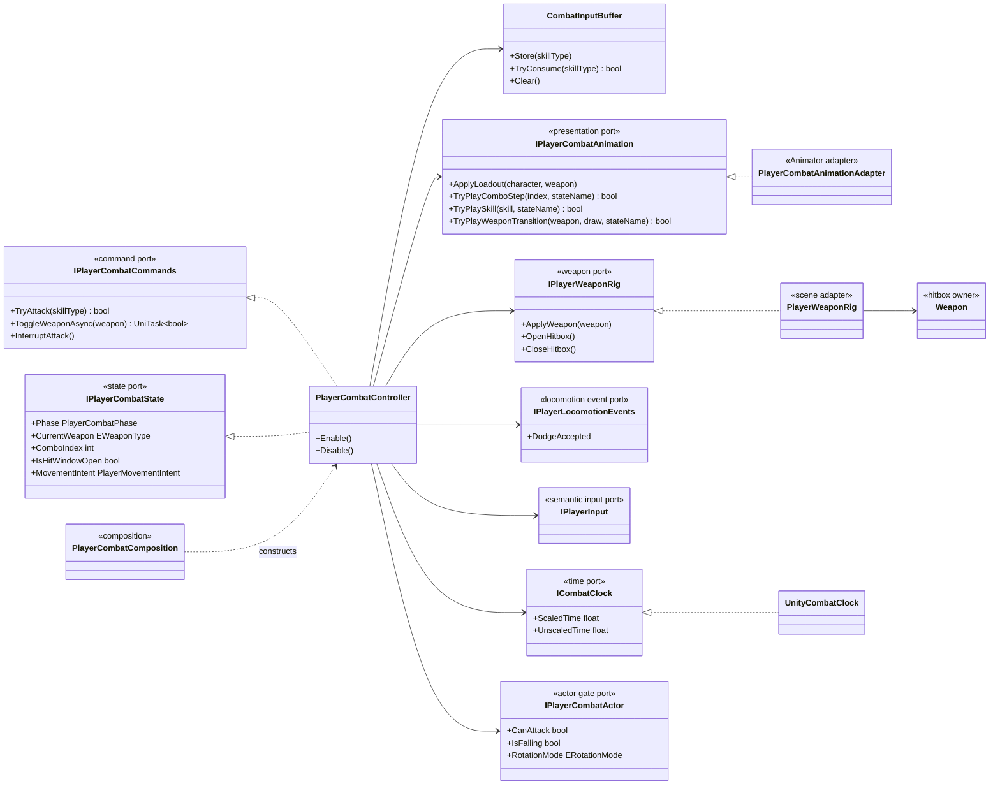
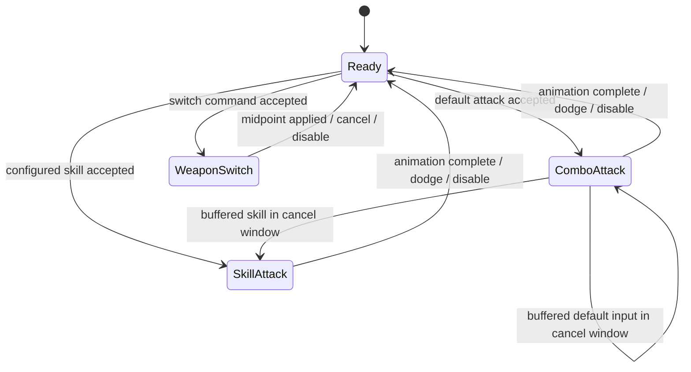
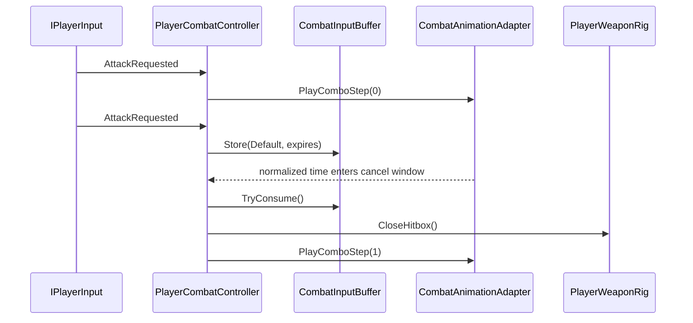

# Project S — Player Combat

## Ответственность

Player Combat владеет подтверждённым боевым состоянием игрока: текущей фазой, экипированным оружием, combo index, input buffer, cooldown навыков и hit window. Он принимает семантические команды и выдаёт ограниченный `PlayerMovementIntent`, но не зависит напрямую от `Character`, не читает устройства ввода и не меняет Animator или collider напрямую.

Текущая реализация сохраняет существующие `AnimationsData`, Animator Controller и настроенные prefab references. Это рефакторинг runtime ownership, а не замена игровых анимаций или создание новой attack authoring model.

## Дерево классов

## Фазы и переходы

`PlayerCombatPhase` имеет один owner — `PlayerCombatController`. Разрешённые переходы проверяются централизованно; отдельные boolean-флаги `IsComboAttack`, `IsSkillAttack` и `IsSwitching` удалены из player flow.

Для четырёх фаз generic state machine пока не добавлена: состояние не содержит самостоятельных state nodes, а переходы синхронизируются с асинхронным Animator adapter. Создание пустого класса на каждую фазу добавило бы только indirection. Если attack definitions получат разные enter/tick/exit policies, этот enum станет естественной границей для `ModularStateMachine`.

## Input buffer и cancel window

Buffer хранит последнюю команду вместе с ограниченным временем жизни `0.35s`. Время жизни считается по unscaled clock, поэтому ввод можно принять во время hit stop. Cooldown навыков использует scaled clock и останавливается вместе с gameplay time.

Новый input не читает `Keyboard.current` или `Gamepad.current`: keyboard, gamepad и будущий mobile UI продолжают входить через `IPlayerInput`.

## Animation и hitbox boundary

`PlayerCombatAnimationAdapter` является единственным участником player combat, который знает про Animator layers, state names и `AnimatorOverrideController`. Override controller создаётся один раз на scope, сбрасывается к исходным clips при смене loadout и уничтожается вместе со scope.

`PlayerWeaponRig` владеет только scene references оружия: переносит weapon transform между holder/hand и открывает или закрывает `Weapon` hitbox по подтверждённому hit window. `Weapon` по-прежнему формирует `DamageInfo` и фильтрует повторное попадание одного owner в пределах окна.

Gameplay не получает damage из animation event. Hit window вычисляется контроллером по текущему animation progress и всегда закрывается при завершении, interruption, disable и cancellation.

## Locomotion и targeting

Combat не вызывает motor. `IPlayerCombatState.MovementIntent` ограничивает translation/jump/dodge и передаётся в `PlayerLocomotionController` через Unity-host. Успешный dodge публикуется узким `IPlayerLocomotionEvents` и прерывает combo/skill.

Combat gates читаются через `IPlayerCombatActor`; controller не получает весь public API legacy `Character`. Реализация порта остаётся тонким `PlayerActorAdapter` без собственного runtime state.

Targeting не является зависимостью Combat на этом этапе. Когда появятся направленные атаки и target assistance, Combat должен читать `IPlayerTargetingState`, но не менять target и не управлять камерой.

## Lifecycle

`Enable` применяет текущий loadout и симметрично подписывает Attack, Skill, Switch и Dodge. `Disable` снимает callbacks, отменяет активную UniTask-операцию, очищает buffer, закрывает hitbox и возвращает phase в `Ready`. Все `CancellationTokenSource` освобождаются владельцем.

Weapon switch использует timeout входа в Animator state, поэтому отсутствующий state не оставляет controller навсегда в `WeaponSwitch`. Смена текущего оружия подтверждается в середине sheathe/unsheathe animation.

## Текущая граница и следующий шаг

Player Combat остаётся в `_App/Core`: его animation state names, hardcoded normalized windows и `AnimationsData` специфичны для Project S. Legacy `CombatControllerBase` сохраняется только для текущего Enemy flow и больше не является базовым классом игрока.

Следующий качественный шаг — заменить общие константы hit/cancel window на `AttackDefinition` для каждой атаки: timings, damage profile, movement intent, cancel rules и presentation references. Такой переход должен выполняться вместе с реальными наземными/воздушными combo requirements, а не как пустая универсальная схема.
