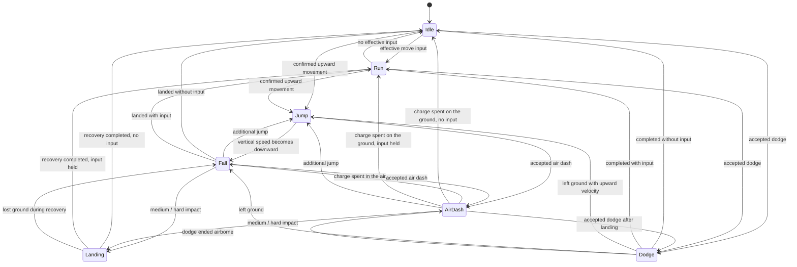
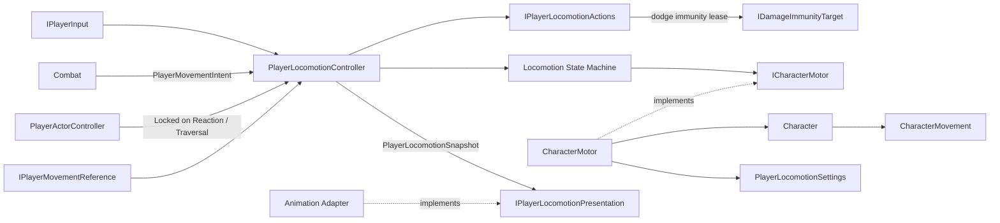

# Project S — Player Locomotion

## Ответственность

Player Locomotion владеет интерпретацией семантического input и текущим locomotion-состоянием игрока. Физическое ядро `CharacterMovement` сохранено: оно выполняет движение capsule, ground/slope checks, step offset, depenetration, столкновения и moving-platform correction.

Внутренняя модель физического ядра описана отдельно в [Character.Movement.md](Character.Movement.md).

Граница специально остаётся внутри `_App`, пока не стабилизированы публичный API, настройки и traversal-сценарии. Сейчас это не UPM-пакет и не `_Modules/CharacterMotion`.

## Дерево классов

```mermaid
classDiagram
    direction LR

    class IPlayerInput {
        <<input port>>
        +Move Vector2
        +WalkChanged
        +SprintChanged
        +JumpChanged
        +DodgeRequested
    }
    class PlayerLocomotionController {
        +CurrentState PlayerLocomotionStateId
        +Snapshot PlayerLocomotionSnapshot
        +BlocksActions bool
        +Enable()
        +Disable()
        +SetMovementIntent(intent)
        +Tick(deltaTime)
        +TryInvertGravity()
    }
    class PlayerMovementIntent {
        +TranslationScale float
        +AllowJump bool
        +AllowDodge bool
        +AllowGuard bool
        +FaceMoveDirection bool
    }
    class PlayerLocomotionSnapshot {
        <<immutable output>>
        +IsValid bool
        +State PlayerLocomotionStateId
        +SpeedMode PlayerSpeedMode
        +Mode PlayerLocomotionMode
        +Velocity Vector3
        +MoveDirection Vector3
        +ForwardSpeed float
        +LateralSpeed float
        +VerticalSpeed float
        +NormalizedSpeed float
        +IsGrounded bool
        +IsCrouched bool
        +DodgeBackwards bool
        +Landing PlayerLanding
    }
    class ICharacterMotor {
        <<motor port>>
        +Jumped
        +Landed(impactSpeed)
        +IsGrounded bool
        +IsFalling bool
        +IsDodging bool
        +IsFlying bool
        +MaxSpeed float
        +GaitSpeed float
        +Velocity Vector3
        +SetMovementDirection(direction)
        +StopPlanarMovement()
        +SnapFacingDirection(direction)
        +PressJump()
        +SetSpeedMode(mode)
    }
    class IPlayerLocomotionActions {
        <<action port>>
        +StartGliding()
        +StopGliding()
        +TryDodge(direction, backwards) bool
    }
    class PlayerLocomotionActions {
        <<action owner>>
        +Enable()
        +Disable()
    }
    class PlayerDodgeAction
    class DodgeSettings {
        <<ScriptableObject authoring>>
        +Duration float
        +InvulnerabilityStart float
        +InvulnerabilityEnd float
    }
    class PlayerGlideAction
    class IDamageImmunityTarget {
        <<shared damage gate port>>
        +IsDamageImmune bool
        +AcquireDamageImmunity() IDisposable
    }
    class PlayerActorAdapter {
        <<damage gate adapter>>
    }
    class Health {
        <<temporary vitality owner>>
        +AcquireDamageImmunity() IDisposable
    }
    class PlayerLocomotionSettings {
        +WalkSpeed float
        +RunSpeed float
        +SprintSpeed float
        +MediumLandingImpactSpeed float
        +HardLandingImpactSpeed float
        +ResolveLanding(impactSpeed) PlayerLanding
    }
    class LandingRecoverySettings {
        <<ScriptableObject authoring>>
        +MediumImpactSpeed float
        +HardImpactSpeed float
        +MediumRecoveryDuration float
        +HardRecoveryDuration float
    }
    class PlayerLanding {
        <<immutable result>>
        +Type PlayerLandingType
        +ImpactSpeed float
        +RecoveryDuration float
        +BlocksActions bool
    }
    class CharacterMotor {
        <<adapter>>
    }
    class Character {
        <<simulation policy>>
    }
    class CharacterMovement {
        <<collision motor>>
    }
    class IPlayerMovementReference {
        <<camera basis port>>
        +ToWorldDirection(input, up, cameraRelative)
    }
    class CameraRelativeMovementReference {
        <<adapter>>
    }
    class ICameraOrientation {
        <<camera read port>>
        +Forward Vector3
        +Right Vector3
    }
    class IStateMachine~PlayerLocomotionStateId~
    class PlayerLocomotionState {
        <<abstract>>
        +Enter()
        +Tick(deltaTime)
        +Exit()
    }
    class PlayerIdleState
    class PlayerRunState
    class PlayerJumpState
    class PlayerFallState
    class PlayerDodgeState
    class PlayerAirDashState
    class PlayerLandingState
    class IPlayerLocomotionPresentation {
        <<presentation port>>
        +Present(snapshot, deltaTime)
        +Reset()
    }
    class IPlayerLocomotionCommands {
        <<command port>>
        +TryInvertGravity() bool
    }
    class IPlayerLocomotionEvents {
        <<confirmed event port>>
        +GroundJumpIntentAccepted
        +JumpAccepted
        +DodgeAccepted
        +Landed PlayerLanding
    }
    class PlayerLocomotionAnimationAdapter
    class PlayerCharacterAnimationPresenter
    class PlayerAnimationCoordinator
    class ICharacterAnimationDriver
    class PlayerLocomotionComposition {
        <<composition>>
    }

    PlayerLocomotionController --> IPlayerInput
    PlayerLocomotionController --> ICharacterMotor
    PlayerLocomotionController --> IPlayerLocomotionActions
    PlayerLocomotionController --> IPlayerMovementReference
    PlayerLocomotionController --> IStateMachine~PlayerLocomotionStateId~
    PlayerLocomotionController --> IPlayerLocomotionPresentation
    PlayerLocomotionController --> PlayerLocomotionSnapshot : publishes
    PlayerLocomotionController --> PlayerLanding : classifies
    IPlayerLocomotionCommands <|.. PlayerLocomotionController
    IPlayerLocomotionEvents <|.. PlayerLocomotionController
    ICharacterMotor <|.. CharacterMotor
    IPlayerLocomotionActions <|.. PlayerLocomotionActions
    PlayerLocomotionActions o-- PlayerDodgeAction
    PlayerLocomotionActions o-- PlayerGlideAction
    PlayerDodgeAction --> DodgeSettings : snapshots values
    PlayerDodgeAction --> IDamageImmunityTarget : owns window lease
    IDamageImmunityTarget <|.. PlayerActorAdapter
    PlayerActorAdapter --> Health : delegates
    CharacterMotor --> Character
    CharacterMotor --> PlayerLocomotionSettings
    PlayerLocomotionSettings --> LandingRecoverySettings : snapshots values
    Character --> CharacterMovement
    IPlayerMovementReference <|.. CameraRelativeMovementReference
    CameraRelativeMovementReference --> ICameraOrientation
    IPlayerLocomotionPresentation <|.. PlayerLocomotionAnimationAdapter
    PlayerLocomotionAnimationAdapter --> PlayerCharacterAnimationPresenter
    PlayerLocomotionAnimationAdapter --> PlayerAnimationCoordinator : dodge request
    PlayerLocomotionAnimationAdapter --> PlayerLocomotionSettings : dodge duration metadata
    PlayerAnimationCoordinator --> ICharacterAnimationDriver : accepted transition
    PlayerCharacterAnimationPresenter --> ICharacterAnimationDriver : locomotion frame
    PlayerLocomotionState <|-- PlayerIdleState
    PlayerLocomotionState <|-- PlayerRunState
    PlayerLocomotionState <|-- PlayerJumpState
    PlayerLocomotionState <|-- PlayerFallState
    PlayerLocomotionState <|-- PlayerDodgeState
    PlayerLocomotionState <|-- PlayerAirDashState
    PlayerLocomotionState <|-- PlayerLandingState
    PlayerLocomotionComposition ..> PlayerLocomotionController : constructs
    PlayerLocomotionComposition ..> CharacterMotor : constructs
    PlayerLocomotionComposition ..> PlayerLocomotionActions : constructs
    PlayerLocomotionComposition ..> PlayerLocomotionSettings : constructs
    PlayerLocomotionComposition ..> IStateMachine~PlayerLocomotionStateId~ : constructs
```

## Состояния

`Jump` начинается не по нажатию кнопки, а после подтверждения motor: `Character` должен перейти в `Falling` и получить восходящую скорость. По той же причине `Dodge` становится активным только после перехода `Character` в custom movement mode. State machine не дублирует физическое состояние заранее.
Если перекат закончился уже вне поверхности, motor-authoritative handoff может
вести из `Dodge` как в восходящий `Jump`, так и в нисходящий `Fall`.

`Walk` и `Sprint` являются взаимоисключающими speed modes, а не отдельными locomotion states. Единственный runtime-owner скорости — `CharacterMotor`. При composition значения `WalkSpeedSettings`, `SprintSpeedSettings`, `DodgeSettings` и `LandingRecoverySettings` один раз переводятся в immutable `PlayerLocomotionSettings`; motor, controller и presentation adapter не читают authoring-каталог независимо.

## Приземление и recovery

`CharacterMovement` подтверждает столкновение с поверхностью, после чего
`Character.Landed` передаёт velocity контакта в `CharacterMotor`. Motor переводит
её в положительную скорость удара вдоль локальной `Up`; высота падения намеренно
не используется, потому что одна и та же высота даёт разные последствия при
другой gravity, начальной velocity или движущейся платформе.

`PlayerLocomotionSettings` классифицирует impact как `Soft / Medium / Hard`.
Текущий профиль использует строгие пороги `> 7 / > 10 m/s`, совпадающие с
conditions текущего XController. `Soft` только публикует
подтверждённое событие и не ухудшает отзывчивость. `Medium` удерживает recovery
`0.64 s`, `Hard` — `0.95 s`; это gameplay timings начала выхода из текущих
`LandMedium` и `LandHard`, а не чтение длины клипа из Animator.

Во время blocking recovery единственный owner — `PlayerLocomotionController`:

- активен явный `Landing` state;
- motor немедленно удаляет остаточную planar velocity и получает нулевое
  movement direction; pending combat action motion тоже очищается и не может
  вернуть translation в следующем physics step;
- jump, dodge, guard, combat entry, weapon switch и traversal отклоняются, но
  bounded combat/input buffers могут дождаться конца recovery;
- поворот по movement input заблокирован;
- animation frame получает `IsMovementLocked`, поэтому XController немедленно
  обнуляет stale `MovementType / MovementDirection` и не использует ошибочный
  ранний выход из landing state;
- scaled timer останавливается вместе с gameplay/Animator при hit stop.

Если поверхность исчезла, recovery отменяется и state переходит в `Fall`.
Reaction/recoil или `Disable` также очищают landing ownership, поэтому старый
recovery не переживает прерывание и повторное включение объекта.

## Dodge и i-frames

Физическое состояние dodge остаётся у `PlayerDodgeAction`, а не у Animator.
После подтверждённого входа в custom movement mode action вычисляет normalized
gameplay time и удерживает lease неуязвимости только внутри окна из
`DodgeSettings`. Текущий Player asset использует окно `0.08...0.58`; при
длительности `0.78s` это примерно `0.06...0.45s`. Startup и recovery остаются
уязвимыми, а изменение длины animation clip не меняет gameplay timing.

Направление на эти числа не влияет: `DodgeSettings` один на оба перекатa, и
`PlayerDodgeAction` тоже один. Длительность, окно неуязвимости, импульс и профиль
скорости у переднего и заднего переката — буквально одни и те же поля, отдельной
настройки по направлению нет. Направление выбирает только клип, поэтому
разбалансировать эти два действия можно лишь содержимым анимации: если один клип
встаёт позже другого, игрок дольше открыт после закрытия окна при равных числах.
Отсюда требование к контенту — одинаковое время возврата в стойку; как оно
обеспечивается, описано в `Docs/Animation/AnimationNaming.md`.

Скорость уворота ведётся кривой `DodgeSettings.SpeedProfile`, а не держится константой. Кривая нормируется по среднему, поэтому её форма меняет только характер рывка, а дальность по-прежнему принадлежит полю `Impulse`. Без неё custom movement mode не трогает скорость вообще — `CustomMovementMode` вызывает пустой хук, — и уворот выглядел как равномерный проезд с мгновенной остановкой в конце.

Нижней границей скорости служит `SetDodgeContinuationSpeed`: контроллер каждый тик считает `PlayerLocomotionRuntime.RequestedSpeed` — `ICharacterMotor.GaitSpeed`, если ввод есть, и ноль, если его нет, — и отдаёт это значение действию. Читать здесь `GetMaxSpeed()` нельзя: во время уворота режим движения `Custom`, а для него метод возвращает `1.0`. Опрос каждый тик означает, что переключение на спринт по ходу переката учитывается, и выход будет на скорости спринта. Уворот не опускается ниже неё и не гасит её на выходе. Поэтому перекат с места заканчивается стоя, а перекат на бегу возвращает в бег, а не в разгон с нуля. Это разные дистанции, и так и должно быть: перекат на бегу проходит дальше.

`RequestedSpeed` попадает и в snapshot: это единственное место, где записано, какое движение игрок просит, пока скоростью владеет действие. Презентация берёт значение оттуда, поэтому смысл «запрошенная походка» не расходится между физикой уворота и анимацией.

`IDamageImmunityTarget` выдаёт `IDisposable` lease вместо записи общего boolean.
Поэтому пересекающиеся окна dodge и combat action независимы: завершение одного
owner не снимает иммунитет второго. `Disable`, внешний выход из dodge и обычное
завершение движения освобождают lease идемпотентно.

## Air dash

Воздушный рывок — не вариант dodge, а собственное действие `PlayerAirDashAction`
в своём custom movement mode `AirDashing`. Разделение вынужденное:
`PlayerDodgeAction` входит только из `IsWalking()`, а `CanConsumeDodgeRequest`
явно отказывает при `IsFalling`. Свести их в одно состояние значило бы сломать
оба условия.

Ввод при этом общий. Та же команда dodge в воздухе маршрутизируется в
`TryAirDash`, поэтому буфер ввода, окно запроса и правила блокировки действий
переиспользуются как есть, а отдельной кнопки не появляется.

Рывок задаётся `AirDashSettings`: импульс, длительность, профиль скорости,
окно неуязвимости и число зарядов на один полёт. Заряды восстанавливает
`OnMotorLanded`, то есть одно касание земли всегда возвращает полный запас
независимо от того, чем полёт закончился.

Рывок строго горизонтален: вертикальная составляющая обнуляется на входе, иначе
рывок на подъёме уносил бы персонажа выше, чем показывает клип, а на падении
съедал бы почти всю дистанцию. Скорость внутри рывка ведётся
`AirDashSettings.SpeedProfile` по тем же правилам, что и у наземного уворота:
кривая нормируется по среднему, дальность остаётся за полем `Impulse`. Раньше
скорость задавалась один раз, а на выходе обнулялась — персонаж вставал колом в
воздухе. Теперь нижней границей выхода служит `ResolveSpeed(1.0f)`: это хвост
профиля либо запрошенная походка, если игрок держит направление.

Направление — `PlayerDodgeDirection` с двумя значениями, как и вся модель
перемещения: дерево локомоции тоже знает только `Forward`/`Backward`. Значение
живёт в snapshot и считается в контроллере проекцией запрошенного направления на
forward персонажа; порог `-0.5` означает, что `Backward` берётся только за
явным отклонением назад, а не по любому заходу за 90°. Считается это лишь в
`OrientToViewAndMovement`, то есть под lock-on: в свободной камере персонаж
разворачивается в сторону движения, поэтому направление всегда `Forward`, а
фейсинг снапится на вектор рывка. Боковые клипы в паке есть
(`Esc_8way_BoostDash_Air`), но под текущую модель перемещения они не нужны.

Презентация идёт слотами `Locomotion.AirDash.Forward/Backward` в состояния
`Locomotion.Jump.AirDash.*`. Драйвер растягивает клип до `AirDashSettings`
длительности тем же механизмом, что и dodge, поэтому длина исходного клипа не
становится gameplay-таймингом. Выход из состояний рывка ведёт прямо в `Fall`, а
не через exit родительской машины: раньше он проходил через `Move`, и персонаж
на ~0.2 с принимал наземную позу idle прямо в воздухе.

## Locomotion snapshot

`PlayerLocomotionController` один раз за frame собирает immutable `PlayerLocomotionSnapshot` после подтверждения motor state и выполнения state-machine tick. Snapshot содержит фактическую velocity, локальные forward/lateral/vertical компоненты, normalized speed, gait, locomotion mode, подтверждённое состояние `Idle / Run / Jump / Fall / Dodge / AirDash / Landing` и semantic landing result.

До первого tick и после `Disable` snapshot имеет `IsValid == false`; consumers не должны трактовать default enum values как подтверждённое состояние.

Animation, Camera, VFX и последующие read-only consumers должны получать locomotion-результат через snapshot либо узкий consumer-specific port. Они не читают `Character`, input и state machine независимо и поэтому не создают конкурирующие копии состояния. `PlayerLocomotionAnimationAdapter` обнаруживает смену presentation state по последовательным snapshot и отправляет dodge request в `PlayerAnimationCoordinator`; сами locomotion states больше не зависят от animation presentation.

`GroundJumpIntentAccepted` публикуется после прохождения grounded/movement gates
и фиксации jump startup. `JumpAccepted` подтверждает последующий
`Character.Jumped`. `Snapshot.IsJumpStarting` остаётся true между окончанием
anticipation и ближайшей physics simulation; если motor не подтверждает прыжок,
bounded scaled-time timeout `0.10 s` снимает reservation и освобождает input.
`DodgeAccepted` публикуется только после принятия запроса `PlayerDodgeAction`.
События изолируют subscribers: ошибка одного consumer не блокирует остальные
реакции на уже принятое locomotion-действие.

## Направление зависимостей

- Gameplay input не знает о клавиатуре, gamepad или bindings.
- Jump/dodge callbacks не меняют gameplay state немедленно: controller защёлкивает
  их до ближайшего locomotion tick, получает уже актуальный `PlayerMovementIntent`
  и затем детерминированно потребляет. При одновременном jump+dodge приоритет имеет
  dodge; jump release всё равно освобождает существующий hold/glide.
- Combat не вызывает `Character.SetMovementDirection`, `Jump`, `Dodge` или Guard. Он передаёт ограниченный intent: масштаб translation, разрешение jump/dodge/guard и запрос разворота по input.
- Во время combat action `AllowJump / AllowDodge / AllowGuard` становятся true
  только внутри его `CancelWindow`. Locomotion и defense проверяют intent до
  запуска действия, а combat получает назад только подтверждённые
  `GroundJumpIntentAccepted / JumpAccepted / DodgeAccepted / GuardStarted` и
  прерывает текущий action. Наземный jump cancel происходит при принятом startup,
  до импульса motor, чтобы animation handoff не задерживался на startup window.
  Пока `Snapshot.IsJumpStarting`, combat availability не запускает новую
  ground-action; последующий input остаётся bounded Ready-entry и после
  подтверждённого takeoff проверяется уже как airborne action. Если takeoff
  отклонён, reservation завершается по timeout и сохранённая команда снова
  проверяется в фактическом environment.
- Camera участвует только как basis для camera-relative направления через отдельный adapter; locomotion не зависит от Cinemachine API.
- Traversal запрашивает инверсию gravity через `IPlayerLocomotionCommands` и меняет camera orientation только после подтверждения команды.
- `PlayerActorController` немедленно передаёт `PlayerMovementIntent.Locked` при non-stable reaction и удерживает ограничения во время traversal. Поэтому jump/dodge callbacks не проходят между межfeature transition и следующим locomotion tick.
- Animation получает подтверждённое состояние и ту же authored длительность
  dodge через `PlayerLocomotionSettings`. Gameplay duration и i-frame window всё
  равно являются авторитетными; editor validator лишь требует, чтобы evade clip
  активного weapon override отличался от них не более чем на `0.05s`.
- Glide и dodge проходят через `IPlayerLocomotionActions`. Их runtime-state принадлежит `PlayerGlideAction` и `PlayerDodgeAction`; общий ability runtime отсутствует.
- `Character` симулируется с `Time.fixedDeltaTime`; presentation обновляется в frame `Update`.

## Lifecycle и ownership

`PlayerLocomotionComposition`, вызванный единственным `GameLifetimeScope`, регистрирует один scoped-набор motor/controller/runtime/state machine для активного Player. `ThirdPersonController` остаётся Unity-host для serialized references, а межfeature-порядком владеет scoped `PlayerActorController`; Combat, Traversal и Camera используют отдельные controllers.

`PlayerLocomotionController.Enable` только подписывает semantic input. Первый motor snapshot и запуск state machine происходят в первом `Tick`, после завершения `Awake` Unity-компонентов; pending action этого же кадра может быть принят до запуска machine и будет отражён после подтверждения motor. Pending jump/dodge signals очищаются при `Disable`, поэтому команда из старого enable-generation не переносится после повторного входа. `Disable` симметрично снимает callbacks, освобождает jump/glide/dodge immunity, сбрасывает speed mode и останавливает state machine.

## Текущая граница

В core locomotion входят `Idle / Run / Jump / Fall / Dodge / Landing`, camera-relative ground/air input, walk/run/sprint, variable jump/glide и impact-based landing recovery. Swimming является отдельной movement policy, а ladder — отдельным Traversal feature и не входит в locomotion API.

Кандидат на `_Modules/CharacterMotion` появляется только после того, как:

- traversal и root motion получат явные контракты;
- параметры движения будут собраны в стабильную authoring model;
- модуль можно будет использовать без `ThirdPersonController`, Combat и assets Project S.
