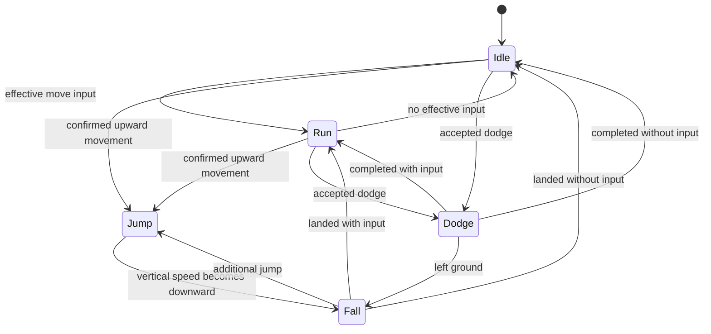
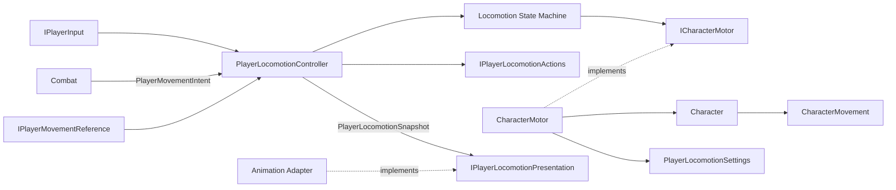

# Project S — Player Locomotion

## Ответственность

Player Locomotion владеет интерпретацией семантического input и текущим locomotion-состоянием игрока. Физическое ядро `CharacterMovement` сохранено: оно выполняет движение capsule, ground/slope checks, step offset, depenetration, столкновения и moving-platform correction.

Внутренняя модель физического ядра описана отдельно в [Character.Movement.md](Character.Movement.md).

Граница специально остаётся внутри `_App`, пока не стабилизированы публичный API, настройки и traversal-сценарии. Сейчас это не UPM-пакет и не `_Modules/CharacterMotion`.

## Дерево классов

```mermaid
classDiagram
    direction LR

    class IPlayerInput {
        <<input port>>
        +Move Vector2
        +WalkChanged
        +SprintChanged
        +JumpChanged
        +DodgeRequested
    }
    class PlayerLocomotionController {
        +CurrentState PlayerLocomotionStateId
        +Snapshot PlayerLocomotionSnapshot
        +Enable()
        +Disable()
        +SetMovementIntent(intent)
        +Tick(deltaTime)
        +TryInvertGravity()
    }
    class PlayerMovementIntent {
        +TranslationScale float
        +AllowJump bool
        +AllowDodge bool
        +FaceMoveDirection bool
    }
    class PlayerLocomotionSnapshot {
        <<immutable output>>
        +IsValid bool
        +State PlayerLocomotionStateId
        +SpeedMode PlayerSpeedMode
        +Mode PlayerLocomotionMode
        +Velocity Vector3
        +MoveDirection Vector3
        +ForwardSpeed float
        +LateralSpeed float
        +VerticalSpeed float
        +NormalizedSpeed float
        +IsGrounded bool
        +IsCrouched bool
        +DodgeBackwards bool
    }
    class ICharacterMotor {
        <<motor port>>
        +IsGrounded bool
        +IsFalling bool
        +IsDodging bool
        +IsFlying bool
        +MaxSpeed float
        +Velocity Vector3
        +SetMovementDirection(direction)
        +SnapFacingDirection(direction)
        +PressJump()
        +SetSpeedMode(mode)
    }
    class IPlayerLocomotionActions {
        <<action port>>
        +StartGliding()
        +StopGliding()
        +TryDodge(direction, backwards) bool
    }
    class PlayerLocomotionActions {
        <<action owner>>
        +Enable()
        +Disable()
    }
    class PlayerDodgeAction
    class PlayerGlideAction
    class PlayerLocomotionSettings {
        +WalkSpeed float
        +RunSpeed float
        +SprintSpeed float
    }
    class CharacterMotor {
        <<adapter>>
    }
    class Character {
        <<simulation policy>>
    }
    class CharacterMovement {
        <<collision motor>>
    }
    class IPlayerMovementReference {
        <<camera basis port>>
        +ToWorldDirection(input, up, cameraRelative)
    }
    class CameraRelativeMovementReference {
        <<adapter>>
    }
    class ICameraOrientation {
        <<camera read port>>
        +Forward Vector3
        +Right Vector3
    }
    class IStateMachine~PlayerLocomotionStateId~
    class PlayerLocomotionState {
        <<abstract>>
        +Enter()
        +Tick(deltaTime)
        +Exit()
    }
    class PlayerIdleState
    class PlayerRunState
    class PlayerJumpState
    class PlayerFallState
    class PlayerDodgeState
    class IPlayerLocomotionPresentation {
        <<presentation port>>
        +Present(snapshot, deltaTime)
        +Reset()
    }
    class IPlayerLocomotionCommands {
        <<command port>>
        +TryInvertGravity() bool
    }
    class PlayerLocomotionAnimationAdapter
    class PlayerCharacterAnimationPresenter
    class ICharacterAnimationDriver
    class PlayerLocomotionComposition {
        <<composition>>
    }

    PlayerLocomotionController --> IPlayerInput
    PlayerLocomotionController --> ICharacterMotor
    PlayerLocomotionController --> IPlayerLocomotionActions
    PlayerLocomotionController --> IPlayerMovementReference
    PlayerLocomotionController --> IStateMachine~PlayerLocomotionStateId~
    PlayerLocomotionController --> IPlayerLocomotionPresentation
    PlayerLocomotionController --> PlayerLocomotionSnapshot : publishes
    IPlayerLocomotionCommands <|.. PlayerLocomotionController
    ICharacterMotor <|.. CharacterMotor
    IPlayerLocomotionActions <|.. PlayerLocomotionActions
    PlayerLocomotionActions o-- PlayerDodgeAction
    PlayerLocomotionActions o-- PlayerGlideAction
    CharacterMotor --> Character
    CharacterMotor --> PlayerLocomotionSettings
    Character --> CharacterMovement
    IPlayerMovementReference <|.. CameraRelativeMovementReference
    CameraRelativeMovementReference --> ICameraOrientation
    IPlayerLocomotionPresentation <|.. PlayerLocomotionAnimationAdapter
    PlayerLocomotionAnimationAdapter --> PlayerCharacterAnimationPresenter
    PlayerLocomotionAnimationAdapter --> ICharacterAnimationDriver : state transitions
    PlayerCharacterAnimationPresenter --> ICharacterAnimationDriver : locomotion frame
    PlayerLocomotionState <|-- PlayerIdleState
    PlayerLocomotionState <|-- PlayerRunState
    PlayerLocomotionState <|-- PlayerJumpState
    PlayerLocomotionState <|-- PlayerFallState
    PlayerLocomotionState <|-- PlayerDodgeState
    PlayerLocomotionComposition ..> PlayerLocomotionController : constructs
    PlayerLocomotionComposition ..> CharacterMotor : constructs
    PlayerLocomotionComposition ..> PlayerLocomotionActions : constructs
    PlayerLocomotionComposition ..> PlayerLocomotionSettings : constructs
    PlayerLocomotionComposition ..> IStateMachine~PlayerLocomotionStateId~ : constructs
```

## Состояния

`Jump` начинается не по нажатию кнопки, а после подтверждения motor: `Character` должен перейти в `Falling` и получить восходящую скорость. По той же причине `Dodge` становится активным только после перехода `Character` в custom movement mode. State machine не дублирует физическое состояние заранее.

`Walk` и `Sprint` являются взаимоисключающими speed modes, а не отдельными locomotion states. Единственный runtime-owner скорости — `CharacterMotor`. При composition значения `WalkSpeedSettings` и `SprintSpeedSettings` один раз переводятся в immutable `PlayerLocomotionSettings`; motor не знает об authoring-каталоге.

## Locomotion snapshot

`PlayerLocomotionController` один раз за frame собирает immutable `PlayerLocomotionSnapshot` после подтверждения motor state и выполнения state-machine tick. Snapshot содержит фактическую velocity, локальные forward/lateral/vertical компоненты, normalized speed, gait, locomotion mode и подтверждённое состояние `Idle / Run / Jump / Fall / Dodge`.

До первого tick и после `Disable` snapshot имеет `IsValid == false`; consumers не должны трактовать default enum values как подтверждённое состояние.

Animation, Camera, VFX и последующие read-only consumers должны получать locomotion-результат через snapshot либо узкий consumer-specific port. Они не читают `Character`, input и state machine независимо и поэтому не создают конкурирующие копии состояния. `PlayerLocomotionAnimationAdapter` обнаруживает смену presentation state по последовательным snapshot и запускает dodge cross-fade; сами locomotion states больше не зависят от animation presentation.

## Направление зависимостей

- Gameplay input не знает о клавиатуре, gamepad или bindings.
- Combat не вызывает `Character.SetMovementDirection`, `Jump` или `Dodge`. Он передаёт ограниченный intent: масштаб translation, разрешение jump/dodge и запрос разворота по input.
- Camera участвует только как basis для camera-relative направления через отдельный adapter; locomotion не зависит от Cinemachine API.
- Traversal запрашивает инверсию gravity через `IPlayerLocomotionCommands` и меняет camera orientation только после подтверждения команды.
- Animation получает подтверждённое состояние. Продолжительность dodge задаётся gameplay-конфигурацией, а не длиной animation clip.
- Glide и dodge проходят через `IPlayerLocomotionActions`. Их runtime-state принадлежит `PlayerGlideAction` и `PlayerDodgeAction`; общий ability runtime отсутствует.
- `Character` симулируется с `Time.fixedDeltaTime`; presentation обновляется в frame `Update`.

## Lifecycle и ownership

`PlayerLocomotionComposition`, вызванный единственным `GameLifetimeScope`, регистрирует один scoped-набор motor/controller/runtime/state machine для активного Player. `ThirdPersonController` остаётся Unity-host для serialized references и временным координатором traversal; Combat и Camera используют отдельные scoped controllers.

`PlayerLocomotionController.Enable` только подписывает semantic input. Первый motor snapshot и запуск state machine происходят в первом `Tick`, после завершения `Awake` Unity-компонентов. `Disable` симметрично снимает callbacks, освобождает jump/glide, сбрасывает speed mode и останавливает state machine.

## Текущая граница

В core locomotion входят `Idle / Run / Jump / Fall / Dodge`, camera-relative ground/air input, walk/run/sprint и variable jump/glide. Swimming является отдельной movement policy, а ladder — отдельным Traversal feature и не входит в locomotion API.

Кандидат на `_Modules/CharacterMotion` появляется только после того, как:

- traversal и root motion получат явные контракты;
- параметры движения будут собраны в стабильную authoring model;
- модуль можно будет использовать без `ThirdPersonController`, Combat и assets Project S.
