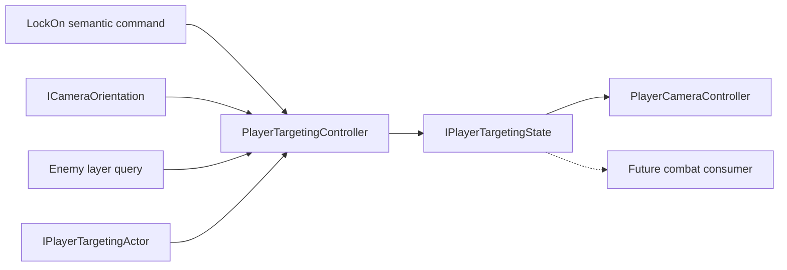

# Project S — Player Targeting

## Ответственность

`PlayerTargetingController` владеет lock-on state и выбором цели. Он обрабатывает семантическую команду LockOn, выполняет ограниченный physics query, выбирает actor, следит за допустимой дистанцией и меняет rotation policy игрока. Он не управляет камерой, Cinemachine и combat execution.

## Дерево классов

```mermaid
classDiagram
    direction LR

    class IPlayerTargetingCommands {
        <<command port>>
        +ToggleLock() bool
        +TryAcquireTarget() bool
        +SwitchTarget(direction) bool
        +ClearTarget()
    }
    class IPlayerTargetingState {
        <<state port>>
        +TargetChanged
        +IsTargetLocked bool
        +CurrentTarget Transform
        +AimPosition Vector3
    }
    class PlayerTargetingController {
        +MaxLockDistance float
        +Enable()
        +Disable()
        +Tick()
    }
    class IPlayerInput {
        <<input port>>
        +LockOnRequested
    }
    class ICameraOrientation {
        <<view port>>
        +Position Vector3
        +Forward Vector3
        +Right Vector3
    }
    class IPlayerTargetingActor {
        <<actor port>>
        +Position Vector3
        +Root Transform
        +RotationMode ERotationMode
        +SetRotationMode(mode)
    }
    class PlayerCameraController {
        <<state consumer>>
    }
    class PlayerTargetingComposition {
        <<composition>>
    }

    IPlayerTargetingCommands <|.. PlayerTargetingController
    IPlayerTargetingState <|.. PlayerTargetingController
    PlayerTargetingController --> IPlayerInput
    PlayerTargetingController --> ICameraOrientation
    PlayerTargetingController --> IPlayerTargetingActor
    PlayerCameraController --> IPlayerTargetingState
    PlayerTargetingComposition ..> PlayerTargetingController : constructs
```

## Выбор цели

Кандидаты собираются через `Physics.OverlapSphereNonAlloc` только по слою `Enemy`. Buffer увеличивается до ограниченного максимума; переполнение не создаёт бесконечный рост памяти.

При выборе controller:

- отбрасывает кандидатов вне view cone;
- сводит составные colliders одного actor к корневому `Character`, чтобы limb collider не становился отдельной целью;
- выбирает ближайшего к направлению центра камеры actor, используя расстояние как дополнительный вес;
- хранит collider для стабильной точки прицеливания через `bounds.center`;
- автоматически снимает lock при уничтожении цели или превышении `MaxLockDistance`.

`SwitchTarget(-1|1)` является платформо-независимой командой для последующего binding на mouse, right stick, touch swipe или UI. Сам binding пока не добавлен.

## Зависимости и ownership

Targeting зависит от read-only camera orientation, но камера зависит только от read-only targeting state. Ни один controller не получает concrete-тип другого через constructor, поэтому нет циклической зависимости.

Доступ к игроку ограничен `IPlayerTargetingActor`: controller читает позицию и может изменить только rotation policy. Concrete `Character` скрыт за `PlayerActorAdapter`; составные colliders целей по-прежнему разрешаются до их корневого `Character` как часть target selection.

Старые `PlayerTargetLockSystem` и дублирующий `TargetLockSystem`, которые напрямую меняли `CinemachineCamera.LookAt` и использовали `Camera.main`, удалены. Enemy targeting пока сохраняет отдельную legacy-ветку `TargetLockSystemBase`; её рефакторинг не входит в player camera scope.

## Почему интерфейсы, а не abstract controller

Здесь сменяемая граница проходит по операциям и состоянию, а не по inheritance tree. `IPlayerTargetingCommands` разрешает отправлять намерения, `IPlayerTargetingState` разрешает наблюдать результат. Новая реализация для soft targeting, aim assist или другого жанра может реализовать эти контракты без наследования lifecycle и physics-алгоритма текущего controller.

Та же модель должна применяться при выделении Combat: отдельные command/state порты вокруг реального владельца combat state. Создавать общий `PlayerControllerBase` или абстрактный класс на каждый gameplay controller не следует.
