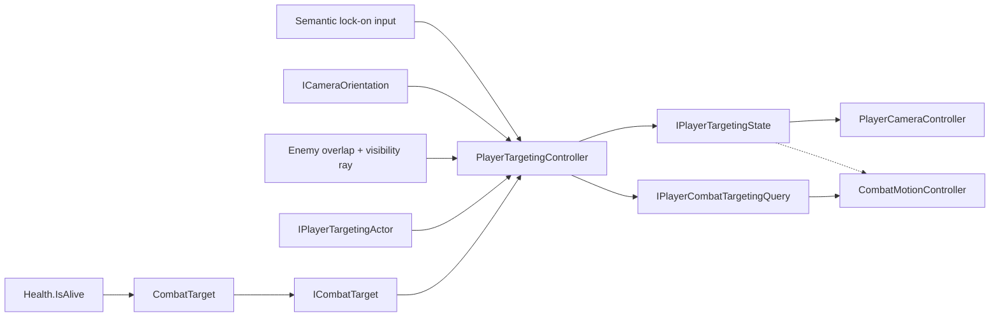

# Project S — Player Targeting

## Ответственность

`PlayerTargetingController` владеет lock-on state, выбором и переключением цели. Он получает семантические команды ввода, выполняет ограниченный physics query, меняет rotation policy игрока и публикует read-only targeting state для камеры. Тот же bounded selection backend предоставляет combat отдельный stateless query для soft assist, не превращая выбранную им цель в lock-on.

`CombatTarget` — явная authoring-граница цели. Он определяет корень actor, точку прицеливания и доступность цели. Случайный collider на слое `Enemy` без `CombatTarget` целью не является.

Targeting не управляет Cinemachine, Animator, damage, AI или смертью персонажа.

## Дерево классов

```mermaid
classDiagram
    direction LR

    class IPlayerTargetingCommands {
        <<command port>>
        +ToggleLock() bool
        +TryAcquireTarget() bool
        +SwitchTarget(direction) bool
        +ClearTarget()
    }
    class IPlayerTargetingState {
        <<state port>>
        +TargetChanged
        +IsTargetLocked bool
        +CurrentTarget Transform
        +AimPosition Vector3
    }
    class IPlayerCombatTargetingQuery {
        <<stateless query port>>
        +TryGetAttackAssistTarget(origin, forward, maxDistance, maxAngle, target) bool
    }
    class ICombatTarget {
        <<target port>>
        +TargetId int
        +IsTargetable bool
        +TargetRoot Transform
        +AimPosition Vector3
    }
    class PlayerTargetingController {
        +MaxLockDistance float
        +Enable()
        +Disable()
        +Tick()
    }
    class CombatTarget {
        -targetRoot Transform
        -aimPoint Transform
        -aimCollider Collider
        -health Health
    }
    class Health {
        <<temporary prototype>>
        +IsAlive bool
    }
    class IPlayerInput {
        <<input port>>
        +LockOnRequested
        +TargetSwitch float
    }
    class ICameraOrientation {
        <<view port>>
        +Position Vector3
        +Forward Vector3
        +Right Vector3
    }
    class IPlayerTargetingActor {
        <<actor port>>
        +Position Vector3
        +Root Transform
        +RotationMode ERotationMode
        +SetRotationMode(mode)
    }
    class PlayerCameraController {
        <<state consumer>>
    }
    class PlayerTargetingComposition {
        <<composition>>
    }

    IPlayerTargetingCommands <|.. PlayerTargetingController
    IPlayerTargetingState <|.. PlayerTargetingController
    IPlayerCombatTargetingQuery <|.. PlayerTargetingController
    ICombatTarget <|.. CombatTarget
    CombatTarget --> Health : temporary availability
    PlayerTargetingController --> IPlayerInput
    PlayerTargetingController --> ICameraOrientation
    PlayerTargetingController --> IPlayerTargetingActor
    PlayerTargetingController --> ICombatTarget : selects
    PlayerCameraController --> IPlayerTargetingState
    PlayerTargetingComposition ..> PlayerTargetingController : constructs
```

## Выбор цели

Кандидаты собираются через `Physics.OverlapSphereNonAlloc` только по слою `Enemy`. Buffer увеличивается до ограниченного максимума и не создаёт неограниченный рост памяти.

Для каждого collider controller ищет `ICombatTarget` вверх по hierarchy и затем:

- отклоняет disabled, destroyed и недоступные цели;
- сводит составные colliders к одному actor через `TargetId`;
- отбрасывает actor вне view cone;
- отклоняет actor, если первый non-trigger ray hit принадлежит препятствию или другой цели;
- использует `AimPosition`, а не положение случайного limb collider;
- при первичном захвате выбирает actor ближе к направлению камеры;
- при переключении выбирает ближайшую цель слева или справа от текущей.

Равные selection score разрешаются через стабильный `TargetId`. Симметричные
цели поэтому не меняют результат только из-за другого порядка colliders в
physics overlap buffer.

Soft attack assist использует тот же deduplication, availability и line-of-sight filter, но получает origin/forward и ограничители от конкретного action. Он выбирает одну цель только при старте атаки по нормализованной сумме углового и дистанционного score. Query не меняет `CurrentTarget`, rotation mode и camera state; hard lock остаётся более сильным источником цели.

Visibility ray исключает physics layer `Player`, игнорирует triggers и принимает цель, только если ближайший hit разрешается в тот же `TargetId`. Для hard-lock acquisition origin берётся из `ICameraOrientation.Position`; для attack assist — из позиции actor со смещением вверх. Активный hard lock повторяет проверку каждый tick и снимается только после `0.75 s` непрерывного перекрытия по unscaled clock; видимый frame сбрасывает grace interval.

Если `CombatTarget` отключён, уничтожен, его `Health` больше не жив или actor вышел за `MaxLockDistance`, controller снимает lock и восстанавливает прежний rotation mode игрока.

`SwitchTarget(-1|1)` получает платформо-независимое направление из `IPlayerInput.TargetSwitch`. Текущие bindings: `Z/C`, `Gamepad rightStick/x` и `Joystick stick/x`. Пороги actuation/release разрешают только одно переключение до возврата оси в dead zone.

## Authoring цели

На корневой объект противника либо на общего родителя его physics colliders добавляется `CombatTarget`:

- `Target Root` — логический корень actor; по умолчанию объект компонента;
- `Aim Point` — предпочтительная явная точка, например грудь или центр босса;
- `Aim Collider` — fallback через `bounds.center`, если `Aim Point` не задан;
- `Health` — текущий опциональный prototype-источник доступности. При отсутствии `Health` цель считается доступной, пока компонент активен.

Collider цели должен находиться на physics layer `Enemy`. Для составного body rig достаточно одного `CombatTarget` на общем родителе: все дочерние colliders разрешаются в один `TargetId`.

`AimPoint` задаётся отдельным стабильным transform под actor root. Его нельзя
привязывать к анимированной кости или вычислять из меняющихся `Collider.bounds`:
иначе idle/reaction клип двигает саму точку, camera lock и BodyLook/HeadLook
начинают преследовать этот шум и визуально дрожат. Высота socket выбирается под
тип персонажа, но его transform не входит в Animator hierarchy. Этот authoring
контракт проверяется командой `Tools/Animation/Validate XController Contract`.

## Зависимости и ownership

Targeting зависит от read-only camera orientation и узкой actor boundary. Камера получает `IPlayerTargetingState`, а combat — state для hard lock и отдельный `IPlayerCombatTargetingQuery` для one-shot assist. `CombatTarget` адаптирует Unity hierarchy и опциональный `Health` к контракту цели, поэтому selection больше не зависит от concrete `Character`, enemy AI или body-collider implementation.

Concrete-ссылка `CombatTarget -> Health` считается временным техническим долгом prototype flow. При реализации `Character Stats and Resources` она заменяется узким read-only life-state port; `ICombatTarget` и алгоритм выбора цели при этом меняться не должны.

Старые `PlayerTargetLockSystem`, `TargetLockSystem` и неиспользуемая inheritance-
ветка `TargetLockSystemBase` удалены. `PlayerTargetingController` является
единственным owner выбора цели; command/query entry points ничего не меняют вне
его `Enable/Disable` lifecycle, а `ClearTarget` остаётся teardown-операцией,
которая всегда освобождает rotation policy.

`TargetChanged` публикуется после подтверждённой смены target/rotation mode через
изолированный read-event. Ошибка UI/camera consumer логируется на player root и
не может отменить lock либо помешать остальным subscribers.

## Почему интерфейсы, а не abstract controller

Сменяемая граница проходит по операциям, состоянию и описанию цели, а не по inheritance tree. Soft targeting, aim assist либо genre-specific selection могут реализовать command/state ports без наследования physics lifecycle текущего controller. Другой вид target authoring может реализовать `ICombatTarget`, не заставляя lock-on знать про конкретного персонажа.
