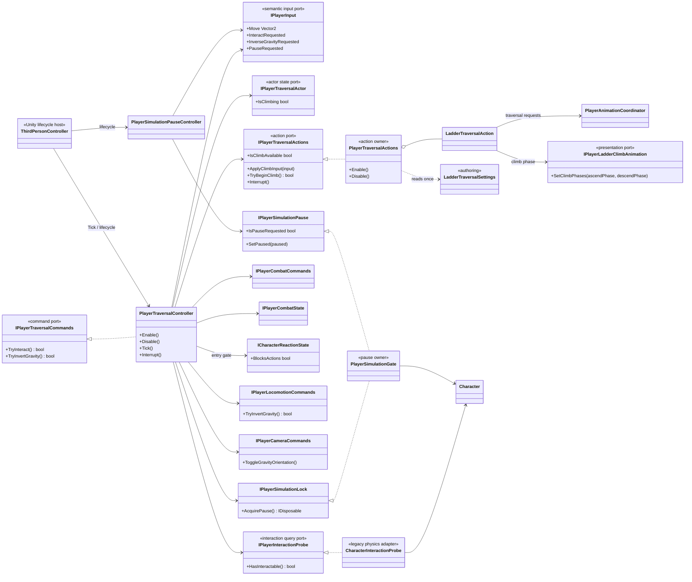
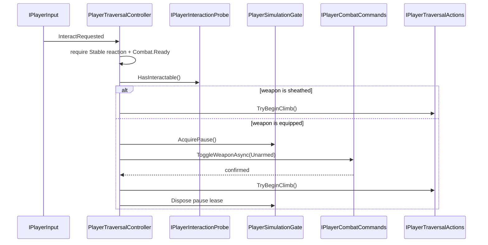

# Project S — Player Traversal

## Ответственность

`PlayerTraversalController` владеет application flow перемещений вне базовой locomotion state machine: взаимодействием с лестницей, передачей climb input, снятием оружия перед входом на лестницу и согласованным разворотом gravity/camera orientation. Начало traversal разрешено только в `Combat.Ready` и при стабильной reaction state. Он не читает Unity devices, не выполняет movement simulation и не управляет Cinemachine или Animator напрямую.

Локальная команда Pause вынесена в `PlayerSimulationPauseController`. Это пауза только симуляции `Character`, а не глобальная пауза игры, UI или времени. Такое название намеренно не обещает будущую pause-menu архитектуру.

## Дерево классов

## Interaction flow

Повторный Interact во время sheathe блокируется владельцем workflow. Reaction interruption инвалидирует ожидающую sheathe-операцию, освобождает pause lease, отменяет ladder UniTask и восстанавливает movement mode/constraints. После этого создаётся новый lifecycle token, поэтому traversal остаётся доступным после возврата reaction в `Stable`. Disable выполняет тот же cleanup без повторного запуска lifecycle; завершившийся позже async continuation не запускает climb и не меняет состояние нового lifecycle.

`CharacterInteractionProbe` сохраняет текущую физическую семантику: `CharacterMovement.OverlapTest`, первый collider и `IInteractable`. Это legacy adapter, а не стабильная универсальная interaction system. Layer mask и выбор лучшего кандидата должны стать отдельной authoring policy только вместе с реальными типами взаимодействий.

`PlayerTraversalController` делегирует конкретную механику в `IPlayerTraversalActions`. `PlayerTraversalActions` создаёт и владеет `LadderTraversalAction`, читая `LadderTraversalSettings` один раз при composition. Общего ability runtime и lookup по concrete type нет. `Interrupt` и `Disable` отменяют активные async ladder operations; отменённый step освобождает только собственный token и не может уничтожить token новой операции.

## Simulation pause ownership

`PlayerSimulationGate` — единственная новая точка, которая вызывает `Character.Pause` в player flow. Постоянный пользовательский pause request и временные locks хранятся раздельно:

- `PlayerSimulationPauseController` меняет persistent request;
- traversal получает disposable lease на время sheathe;
- фактическая симуляция возобновляется только когда request снят и все leases освобождены.

При обычном `Disable` pause controller снимает persistent request до разрушения Unity-компонентов, а traversal освобождает свои leases. `PlayerSimulationGate.Dispose` только инвалидирует scoped state и не вызывает `Character.Pause`: к моменту container teardown Unity уже может уничтожить `CharacterMovement`.

Это предотвращает ситуацию, когда завершение traversal случайно снимает паузу, установленную другим владельцем. Глобальный pause menu в будущем должен иметь отдельный owner времени и action maps; текущий gate не следует расширять до глобального service locator.

## Gravity inversion

Traversal вызывает `IPlayerLocomotionCommands.TryInvertGravity`. Только после подтверждения motor он отправляет `ToggleGravityOrientation` через camera command port. Camera и locomotion не получают concrete-ссылки друг на друга, а orientation presentation не расходится с gameplay gravity при отклонённой команде.

## ThirdPersonController и lifecycle

`ThirdPersonController` теперь содержит serialized authoring references, порядок `Enable/Disable`, frame ticks и compatibility entry point `InverseGravity`. Он больше не:

- подписывается на Interact/Pause/InverseGravity input;
- выполняет physics interaction query;
- знает о `Character` и climbing state;
- владеет async sheathe-and-climb workflow;
- соединяет `PhysicsVolumeChanged` с animation напрямую.

Последняя связь вынесена в `PlayerPhysicsVolumeAnimationAdapter`, который симметрично подписывается и отписывается вместе с lifecycle host.

`PlayerTraversalComposition` регистрирует probe, traversal controller, pause controller и один scoped `PlayerSimulationGate`. Scene/prefab wiring не требуется.

## Геометрия лестницы

`Ladder` описывает рейки в системе координат самой лестницы: `_firstRungOffset` — центр
первой рейки, `_rungSpacing` — шаг, `_rungHalfWidth` — половина её длины; все три
величины локальные и умножаются на `lossyScale`. Раньше начало отсчёта брали от
`BottomAnchorPoint`, то есть от точки, где стоит таз персонажа, а она вынесена вперёд от
плоскости перекладин на длину вытянутой руки — на `Ladder_01` это `0.205` м. Из-за этого
`NearestRungPoint` возвращал точку в `0.205` м позади настоящей перекладины, и IK тянул
кисти внутрь лестницы. Половину ширины тоже читали в мировых единицах, а умножали на
масштаб `0.4`, поэтому кисти сводило к осевой линии на `0.11` м.

Эталон — `Ladder_01`: рейки через `0.26` м при масштабе `0.4`, первая на `0.223` м,
перекладина длиной `0.36` м. Клип поднимает конечности ровно на `0.52` м, значит цикл
кроет две рейки без остатка.

`LadderTraversalSettings.AscendCycleRise` хранит именно авторскую высоту цикла — то, на
сколько клип поднимает руки и ноги за один проход. Это измеримое свойство ассета, а не
подобранное число: конечности в `Ladder_Ascend_Loop` проходят `0.522` м каждая.

`ResolveStepHeight` округляет её до целого числа реек, а `ResolvePathLength` округляет
высоту лестницы до целого числа таких шагов. Это даёт главное свойство подъёма: дорога
от нижнего якоря до верхнего — ровно `8` циклов клипа, поэтому в момент выхода наверху
цикл всегда стоит на фазе `0`.

Все лестницы сцены — экземпляры `Ladder_01`. Прежние `Ladder_02` и `Ladder_03` были
наклонными, с шагом `0.773` и `0.725` м, и под текущий набор клипов не годились.

Известное расхождение: раскладка `19` реек через `0.26` м есть только у экземпляра
`Ladder_01` на `PrototypeArena`, и держится она на overrides сцены. В самом префабе
осталась прежняя модель — `10` реек через `0.32` м. Её и показывают экземпляры
`Ladder_02` и `Ladder_03` на той же сцене, а параметры `Ladder` у всех трёх общие,
поэтому хват на этих двух ложится мимо видимых реек.

## Непрерывный подъём

Раньше каждое нажатие «вверх» запускало отдельный `Step`: `CrossFade` в `Ladder_Ascend`,
линейное смещение на шаг, возврат в `Ladder_Idle`. Клип при этом рестартовал с нулевой
фазы каждый цикл, а в аниматоре у `Ladder_Ascend` и `Ladder_Descend` висел выход в
`Ladder_Idle` по `exitTime 0.99`. На каждом цикле получалось два блендинга подряд, и тело
успевало «осесть» и дёрнуться обратно.

Теперь состояние подъёма включается один раз и крутится, пока игрок держит направление;
выходы в `Ladder_Idle` из обоих loop-состояний удалены. Положение на лестнице хранит
одно число — `_climbCycles`, число циклов клипа от нижнего якоря. Меняет его знаковая
скорость `_climbVelocity`: она разгоняется и тормозит за `ClimbRateBlendSeconds`, а при
смене направления проходит через ноль, не перескакивая. Из `_climbCycles` выводятся и
позиция персонажа, и фаза обоих loop-клипов, поэтому фаза клипа и высота заперты друг
на друга по построению, а не по совпадению двух темпов.

Фазу в аниматор передаёт порт `IPlayerLadderClimbAnimation.SetClimbPhases`. У
`Ladder_Ascend` и `Ladder_Descend` включён Motion Time: время состояния берётся из
параметров `LadderAscendPhase` и `LadderDescendPhase`, собственного темпа у них нет.
Подъём получает `frac(c)`, спуск — `frac(-c)`. Это работает, потому что
`Ladder_Descend` — почти точное обращение `Ladder_Ascend` во времени: поза спуска в фазе
`1 - p` совпадает с позой подъёма в фазе `p`, конечности расходятся не больше чем на
`0.057` м. Разворот стика поэтому не перезапускает цикл, а ведёт ту же позу назад, и
кроссфейд между состояниями смешивает две почти одинаковые позы.

Раньше смена направления запускала другой loop-клип с нулевой фазы, и на развороте
персонаж менял ноги: конечности уходили против нового направления на `0.15–0.24` м.
Сейчас после прохода скорости через ноль ни одна конечность не уходит против
направления дальше `0.025` м — столько же, сколько в ровном спуске. Пока скорость
гаснет (`0.12` с), переносимая конечность успевает продолжить движение на `0.17` м и
затем возвращается тем же путём. Это инерция `ClimbRateBlendSeconds`, а не смена ног.

Отпущенный стик не переключает состояние и не останавливает подъём на месте: персонаж
доводит движение до ближайшей фазы, где все четыре конечности держат перекладины, — см.
«Остановка на перекладинах». Позы `Ladder_Idle` в лазании больше нет
вовсе — слот остаётся замаплен, но не выбирается. Причина замерена: по major bones поза
`Ladder_Idle` расходится с `Ladder_Ascend` минимум на `34.8°` (в фазе `0.78`) и на `65.9°`
в фазе `0`, тогда как остальное семейство сходится вокруг фазы `0` подъёма — конец
`Ladder_Enter_Bottom` даёт `28.8°`, конец `Trav_Ladder_EnterTop_B` — `23.6°`, начало
`Ladder_Exit_Bottom` — `28.8°`, а начало `Ladder_Exit_Top` совпадает с ней ровно, `0.0°`.
Поэтому канонической позой захвата взята фаза `0` цикла подъёма, а не отдельный idle.

Стык входа с этой позой сдвинут раньше конца входа. Прежде кроссфейд в `Ladder_Ascend`
начинался только после того, как клип входа доигрывал: движение обрывалось на последнем
кадре, и следующие `0.18` с поза захвата смешивалась с уже замершим кадром. Теперь
`BlendIntoHang` запускает кроссфейд за `HangBlendLeadSeconds` до конца входа — `0.18` с,
ровно `LadderCrossFadeSeconds`, — и смешивание заканчивается вместе с клипом. Поворот и
позиция по-прежнему фиксируются в `CompleteGrab` после входа, и управление подъёмом
включается только тогда. На стыке входа сверху с захватом наибольшее изменение скорости
конечности за кадр упало с `2.50` до `0.72` м/с.

`PlayerTraversalController.Tick` теперь зовёт `ApplyClimbInput` каждый кадр, пока
персонаж лезет. Прежний порог по величине стика означал, что на нулевом вводе действие
вообще не получало тика, то есть не могло ни затормозить, ни остановить клип.

## Выход наверху

`Ladder_Exit_Top` — единственный клип семейства, который несёт собственный рут-моушен:
за 1.833 с он поднимает персонажа на `0.786` м и выносит вперёд на `0.411` м. Форма
движения нелинейная: вертикаль набирается рывками до `nt 0.58` и дальше стоит на месте,
горизонталь трогается только с `nt 0.20` и идёт до самого конца.

Прежний код вёл персонажа двумя линейными отрезками — сначала весь подъём за `35/55`
клипа, потом весь вынос за `15/55`. Отсюда и брались претензии к выходу: на стыке
отрезков скорость меняла направление на прямой угол, по вертикали персонаж уезжал
вперёд авторской кривой до `8` см, по горизонтали отставал до `15` см, и всё это время
ступни скользили по перекладинам.

Теперь `FollowExitTopProfile` ведёт трансформ по двум нормированным кривым из
`LadderTraversalSettings` — доля подъёма и доля выноса от нормированного времени клипа.
Кривые сняты с самого клипа как разница между позой с запечённым рут-моушеном и позой
в runtime, где `applyRootMotion` выключен и рут из позы вычтен; по 17 и 21 ключу они
воспроизводят замер до миллиметра. Дистанция берётся из геометрии (`от верхнего якоря
до TopPoint`), то есть кривая задаёт только форму, а лестница — масштаб.

Метод снятия стоит записать, он неочевиден. `AnimationClip.SampleAnimation` в редакторе
кладёт рут-моушен обратно в позу, а runtime с `applyRootMotion = false` его убирает.
Разность двух замеров одного и того же кадра и есть авторское смещение рута. Проверять
надо на одном и том же объекте и в одной системе координат: `InverseTransformPoint` на
`CharacterVisual` даёт значения в `2` раза больше мировых, потому что у объекта
`lossyScale 0.5`.

Оставшиеся клипы измерены там же: `Ladder_Enter_Bottom` и `Ladder_Exit_Bottom`
рут-моушена не несут, их перемещение остаётся на коде. С входом сверху сложнее — см.
следующий раздел.

## Вход сверху

`Trav_Ladder_EnterTop_B` рут-моушена тоже не несёт, но по другой причине. У исходного
`SK_Mannequin@Ladder_Exit_Back_Dn.fbx` в импорте включено запекание рут-моушена в позу
(`loopBlendPositionY/XZ: 1`), а спуска в позе нет: `RootT.y` за весь клип меняется на
`+0.08` нормированной единицы, хотя персонаж должен опуститься на `0.77` м. Траектория
корня потерялась ещё при экспорте пака, а сам клип нарисован под корень, который
опускается и отходит назад: в системе корня стоящие на платформе стопы «поднимаются» и
«уезжают вперёд».

Прежний код заменял эту траекторию двумя прямыми — `0.46` м назад за первые `30%`
клипа, потом строго вниз. Замер в play mode на той же позе: стопы, которые по клипу
стоят на платформе, уезжали от точки опоры на `0.199` м, руки на перекладинах — на
`0.083` м.

Траектория восстановлена из самого клипа. Кривые IK-целей рук и ног
(`LeftFootT`, `RightHandT` и т. д.) переводятся в систему корня через `RootT`/`RootQ`;
пока конечность стоит на опоре, там она смещается ровно на минус движение корня. На
каждом шаге берётся пара конечностей, чьи смещения совпадают, и их общее смещение
считается шагом корня. Надёжно восстанавливаются два участка:

- `0–0.5` с — обе стопы на платформе, расхождение пары `0.000`. Корень отходит назад на
  `0.10` м и начинает опускаться только с `0.33` с;
- `1.1–1.83` с — руки и стопа на перекладинах, расхождение не больше `0.007`. Два
  толчка вниз с паузой, как в цикле подъёма.

Между ними, `0.5–1.1` с, персонаж шагает с края, и общей опоры у пары конечностей нет;
этот участок не замерен, а заполнен кубической интерполяцией по позициям и скоростям
на границах. Итог записан двумя кривыми в `LadderTraversalSettings` — доля спуска и
доля отхода назад — и проигрывается тем же `FollowRootProfile`, что и выход. Кривая
отхода переходит единицу до `1.096`: тело уходит на `4.6` см дальше якоря и
возвращается, поэтому значения кривых больше не обрезаются до `[0, 1]`.

После правки тот же замер: стопы на платформе `0.030` м, руки на перекладинах
`0.033` м, наибольшее смещение конечности за кадр `0.0136` м против `0.0224` м. Вход
заканчивается точно в верхнем якоре, стык с позой захвата — `0.0001` м за кадр.

## Хват за рейки

`LadderGripIkAdapter` висит на объекте с `Animator` и работает только в `OnAnimatorIK`
базового слоя, у которого IK pass уже включён. Состояние он читает через порт
`IPlayerLadderGrip`, который реализует `PlayerTraversalActions`; собственной игровой
логики у адаптера нет.

Адаптер различает опорную и переносимую конечность по её собственной скорости. Пока
скорость ниже `_plantSpeed`, конечность считается стоящей на рейке: цель защёлкивается
один раз и держится, вес плавно набирается. Как только конечность пошла — цель
сбрасывается, вес уходит в ноль, и клип ведёт руку сам. Без этого IK каждый кадр брал
`NearestRungPoint` от текущего положения, и в середине переноса цель перескакивала на
следующую перекладину: замер давал скачок кисти на `0.25` м за один кадр дважды за цикл.

Три правила делают обе границы непрерывными:

- защёлкивается только конечность, которая реально рядом с перекладиной — дальше
  `_latchDistance` цель не берётся вовсе;
- поправка считается, пока конечность стоит, и замораживается в момент отрыва, поэтому
  при сходе веса рука идёт строго по клипу плюс убывающее смещение, а не тянется к
  устаревшей цели;
- перезахват запрещён, пока вес не сошёл в ноль. Без этого конечность успевала
  перецепиться посреди отпускания: скорость колебалась около порога, цель бралась
  заново в `0.12` м от текущего положения, и кисть прыгала на `6` см за кадр.

Хват держится и во время выхода: `IsGripActive` покрывает состояние `Releasing`, иначе
руки отпускали лестницу в первом же кадре выхода, хотя по клипу они держатся почти до
середины. Отпускает их теперь сам детектор опоры, когда рука пошла.

Замеры на подъёме (`Ladder_02`, 2474 кадра с опорной кистью): отклонение кисти от рейки
`0.0015` м в среднем при пике `0.059` м, `2473` кадра из `2474` — меньше сантиметра.
Максимальное смещение кисти за кадр на подъёме упало с `0.253` м до `0.026` м, на
выходе наверху — с `0.063` м до `0.024` м, и оставшийся пик приходится на один кадр
переноса стопы на площадку, то есть на сам клип, а не на IK.

Цель хвата — не центр перекладины. IK-цель стопы — голеностоп, и у стопы, которая по
клипу стоит на рейке, он находится на `0.127` м выше оси перекладины и на `0.041` м
ближе к персонажу. У кисти цель — запястье, на `0.028` м выше и на `0.008` м глубже к
стене. Раньше IK тянул голеностоп в центр перекладины, то есть стопу — сквозь неё.
Теперь `ResolveRungOffset` даёт смещение своей конечности: ближайшая рейка ищется от
`animated - offset`, а цель — `rung + offset`. Смещения сняты с клипа в кадрах опоры и
лежат в сериализованных полях адаптера.

С правильной целью поправка стала маленькой, и пределы ужаты: `_maxCorrection` с
`0.14` до `0.06` м, `_latchDistance` с `0.16` до `0.08` м. Конечность, которая по клипу
дальше от рейки, не защёлкивается и идёт по клипу.

`Ladder` знает число реек — `_rungCount`, у `Ladder_01` их `19`. `NearestRungPoint`
ограничивает номер рейки отрезком `[0, _rungCount - 1]`. Без этого на выходе наверху
округление находило несуществующие рейки над лестницей, и кисти защёлкивались на воздух.

У основания левая стопа стоит не на рейке, а на земле, и клипы входа и выхода снизу
ставят её в другую точку, чем цикл: на `0.147` м дальше от лестницы и левее. Остальные
конечности в обеих позах совпадают. Поэтому на кроссфейдах входа и выхода стопа ехала
по земле без шага — `0.148` и `0.165` м за `0.18` с.

Теперь адаптер держит её у основания. Порт `IPlayerLadderGrip` отдаёт для этого
`IsBaseTransition` — идёт вход или выход через основание — и `ClimbCycles`, положение
на лестнице в циклах. Во время входа и выхода снизу цель стопы — абсолютная точка клипов
входа (`_baseFootEntryOffset` от нижнего якоря). В цикле цель — поза хвата плюс смещение
`entry - climb`, и смещение сходит на нет за первый шаг: между `0.10` цикла, фазой отрыва
стопы в `Ladder_Ascend`, и `0.22`, где стопа проходит первую перекладину. Окно
кончается раньше нижней фазы покоя `0.30` (см. «Остановка на перекладинах»), поэтому в
покое у основания смещения уже нет и стопа стоит на своей ступеньке. Стопа уходит наверх из той
точки, где реально стояла, а на спуске последний шаг приводит её в точку выхода.
Смещение прибавляется к позиции хвата, а не к чистому клипу: иначе в конце окна вес
удержания оставался единицей при почти нулевом смещении и перекрывал хват за рейку —
стопа зависала в `4.9` см от перекладины. Абсолютная
цель в самом цикле не годится: по клипу стопа начинает смещаться за `1.5` см до отрыва,
и переключение на `0.10` давало скачок; поэтому смена цели после входа тоже
растягивается на `_blendSeconds`.

Вес IK этой стопы переходит между весом хвата за рейку и единицей плавно, вместе с
целью. Mecanim решает конечность нелинейно по весу: та же итоговая точка при весе `1` и
при весе `0.75` с полной поправкой даёт разные позы, и резкая смена веса стоила скачка
`1.1` см.

Замер на полном маршруте: путь левой стопы на кроссфейде входа снизу `0.148 → 0.000` м,
выхода — `0.165 → 0.000` м. Разворот посреди первого шага у основания — `1.01` м/с
изменения скорости за кадр, подъём — `2.11`, то есть новых рывков нет.

### Остановка на перекладинах

В цикле подъёма нет фазы, где все четыре конечности стоят на перекладинах: каждая кисть
находится в переносе почти половину цикла (`0.30–0.80` и `0.80–0.25`), стопы — по трети
(`0.10–0.45` и `0.60–0.95`). Поэтому остановка в произвольной фазе оставляла руку или
ногу в воздухе, в том числе в позе сразу после входа: у фазы `0` правая кисть в `19` см
от перекладины.

Подходящая фаза найдена по карте ступенек и замером с работающим хватом и отступом
корпуса: персонаж ставился в каждую фазу-кандидат подходом снизу и сверху, и после
установки IK мерилось расстояние от каждой кисти и стопы до точки хвата и номер
ступеньки под ней. Ближе всего к перекладинам все четыре конечности в фазах `0.22` и
`0.74`, но там переносимая стопа проходит ступеньку второй ноги, и хват ставил обе ноги
на одну перекладину. Фазы, где ноги на разных ступеньках, а руки на перекладинах, в
цикле одна — около `0.30`: правая кисть только что взялась, левая только начинает
отрываться, левая стопа подходит к своей ступеньке. Поза — диагональ: руки на
ступеньках `k+2` и `k+3`, ноги на `k+1` и `k`. Во второй половине цикла такой фазы нет:
около `0.85` правая рука или нога остаётся в `5–10` см от перекладины.

Фаза хранится в `LadderTraversalSettings.RestPhases` — одна, `0.30`, то есть цикл
подъёма всегда завершается захватом. Когда направление не нажато, `LadderTraversalAction`
выбирает цель один раз и держит её, пока снова не нажато направление:

- в движении — ближайшую фазу покоя по ходу, но не ближе тормозного пути, чтобы не
  тормозить резче, чем обычно;
- если по ходу до конца лестницы фаз покоя не осталось (выше `Top - 0.70` при подъёме,
  ниже `0.30` при спуске), целью становится якорь, и персонаж сходит с лестницы, а не
  откатывается назад;
- стоя на месте — ближайшую в любую сторону в пределах первой и последней фазы покоя.

Скорость к цели — тормозной профиль `sqrt(2 · a · Δ)` с тем же ускорением, что у
обычного разгона, поэтому остановка не резче торможения. Проверка выхода в
`AdvanceClimb` берёт скорость до остановки на цели, иначе персонаж мог замереть на самом
якоре. После входа цель выбирается сама: снизу персонаж поднимается до `0.30`, сверху
опускается до `Top - 0.70` (`0.36` м). Короткое нажатие переводит на следующую фазу
покоя — шаг до целого цикла, `0.52` м.

В покое хват держит конечности на полную силу. Когда все четыре конечности защёлкнуты
на перекладинах, `LadderGripIkAdapter` плавно поднимает вес хвата до единицы вместо
`0.9` у кистей и `0.75` у стоп, и стопы встают точно на ступеньки. Левая кисть в фазе
`0.30` уже отрывается, и с отступом корпуса рука до перекладины не дотягивается: `2.7`
см. Поэтому в покое корпус наклоняется к лестнице на `_restLeanDegrees` (`12°`) —
поворот `Animator.bodyRotation` вокруг поперечной оси лестницы. Плечи подходят ближе, а
таз с коленями уходит назад. Замер в покое: левая кисть `2.7 → 0.5` см (при `5°` —
`1.8`, при `8°` — `1.2`), голова в `9` см от перекладин, торс в `11` см.

Замер: все остановки после подъёма, спуска, короткого нажатия и после входов приходятся
точно на фазу `0.30`; кисти и стопы в `0–0.9` см от точек хвата, ноги на разных
ступеньках, руки тоже. Отпускание у верхнего и нижнего края доводит до выхода.
Торможение даёт не больше `1.8` м/с изменения скорости конечности за кадр — как обычный
подъём.

Ловушка при правке значений по умолчанию: при перезагрузке домена Unity сохраняет
текущие значения полей у загруженных ассетов и объектов сцены. Новое значение
инициализатора в коде не доходит до уже открытого `LadderClimbAbilityData` или
`Player`, пока их не перезагрузить, поэтому фазы покоя и окно стопы записаны в ассет и
префаб явно.

### Отступ корпуса от лестницы

Клип подъёма держит кисти примерно на `3` см ближе к корню, чем стоят рейки
`Ladder_01`, а колени при этом выносит вперёд: на прежней дистанции голени входили в
рейки в `70%` кадров подъёма и спуска, до `8` см за переднюю грань, бёдра задевали
стойки. Замер — запечённый меш (`SkinnedMeshRenderer.BakeMesh(mesh, false)`; с `true`
у модели с `lossyScale 0.5` вершины выходят вдвое крупнее) против коробок реек и стоек.

Сдвинуть сам корень назад нельзя: кисти и стопы перестают дотягиваться, поправка IK
упирается в `_maxCorrection` в `34–100%` кадров. Поэтому сдвигается только корпус.
`LadderGripIkAdapter` в IK-проходе уводит `Animator.bodyPosition` от лестницы на
`_bodyStandoff` (`0.05` м), а все четыре конечности держит на их несдвинутых позициях:
позиции клипа читаются до сдвига, цели хвата считаются от них, и предел коррекции не
меняется. Корень персонажа остаётся на линии лазания, входы и выходы не затронуты.
Отступ включается, пока персонаж висит на лестнице (`IPlayerLadderGrip.IsHanging`), и
плавно (`_standoffBlendSeconds`, `0.25` с, сглаживание `SmoothStep`) уходит в начале
выхода.

| отступ | голени в рейках | бёдра в стойках/рейках | промах кистей до цели, средний / максимум |
|---|---|---|---|
| `0` | `69–72%` кадров, до `8` см | `4–9%` | — |
| `0.05` м | `39–41%`, до `3.6` см | `0–2%` | `0.1–0.2` / `3.8` см |
| `0.08` м | `14%`, до `1.4` см | `0%` | `0.5–0.6` / `6.2` см — руки уже не дотягиваются |

Предплечья у запястья по-прежнему касаются реек: кисть держит перекладину, и это не
зависит от отступа.

Вес IK у Mecanim нелинеен: одна и та же итоговая точка при весе `1` и при весе хвата с
полной поправкой даёт разные позы, а переключение веса между `0` и `1` давало скачки
кистей до `8–20` м/с. Поэтому вес везде меняется непрерывно — от веса хвата к единице
по мере включения отступа, — а цель смешивается позицией. Поправка отпущенной
конечности после того, как её вес сошёл в ноль, плавно гасится: иначе на затухании
отступа её застывшее значение давало скачок `3` мм в кадр, когда цель переключалась.

Методика: метрика рывка считается по игровому `Time.deltaTime`, а не по реальному
времени между кадрами. Подвисание редактора дало одиночный кадр с `deltaTime 0.012` с
при `0.003` с реального времени, и по реальному времени это читалось как скачок руки
`8` м/с, хотя по игровому скорость была ровной.

Финальный прогон всего маршрута — вход снизу, подъём с остановкой и разворотом, выход
наверху, вход сверху, спуск, выход внизу — по наибольшему изменению скорости конечности
за кадр: подъём `3.63 → 2.16` м/с, спуск `4.63 → 3.90`, выход наверху `2.46 → 1.46`,
выход внизу `3.19 → 1.49`. Оставшийся пик спуска — правая стопа в момент постановки на
рейку. Он остаётся и при IK только на руках, то есть нарисован в самом клипе.

## Ladder presentation binding

`LadderTraversalAction` играет восемь слотов: вход сверху спереди и сзади, вход снизу,
idle, подъём, спуск, выход сверху и снизу. Они замаплены в `PlayerAnimatorActions` на
действие `LadderTraversal` с вариантами 0..7, а `XControllerAnimationContract.TraversalStatePaths`
задаёт соответствующие состояния `Base Layer.Ladder.*`. Длительности клипов авторятся в
`LadderTraversalSettings` и передаются в `CrossFade` как duration override — константы
длин в коде не хранятся. Кроссфейд ladder-слотов вынесен из `DodgeCrossFadeSeconds` в
свой `LadderCrossFadeSeconds` — `0.18` с вместо `0.10`.

`SetPlaybackSpeed` в `XControllerCharacterAnimationDriver` больше не трогает
`Animator.speed`, а только пишет параметр `SpeedMultiplier`. Раньше темп применялся
дважды — и глобально, и через параметр состояния, — поэтому спринт по лестнице шёл не в
`1.5`, а в `2.25` раза быстрее; заодно остановка темпа замораживала весь аниматор, а не
только лестничные состояния. После перевода циклов на Motion Time (см. «Непрерывный
подъём») лестница `SetPlaybackSpeed` больше не вызывает, и `SpeedMultiplier` не читает ни
одно состояние XController.

У всех восьми лестничных состояний включён `IK On Feet`, как у `Move`. Пока флаг у
соседних состояний разный, стопы на переходе перескакивают между позой с коррекцией и
без неё. На стыках `Move → Ladder_Enter_Bottom` и `Ladder_Exit_Top → Move` это давало
изменение скорости стопы за кадр `8.3` и `9.6` м/с, после правки — `1.1` и `0.5` м/с.

Вход сверху использует только слот `LadderEnterTopBack`. Второй клип семейства
разворачивает тело на 197° и заканчивается с тазом в 179° от позы захвата, то есть не
стыкуется с лазанием ни при каком довороте трансформа; прежний код доворачивал трансформ
ещё на 180° поверх этого, и разворот применялся дважды. Направление подхода теперь
отрабатывается на фазе подхода: `ApproachLadder` доводит персонажа до якоря и в
каноническую ориентацию лестницы за время, пропорциональное и дистанции, и углу
разворота (`ApproachSpeed`, `ApproachTurnSpeed`). Слот `LadderEnterTopFront` остаётся
замаплен, но не выбирается — он ждёт корректного клипа с разворотом.

`CanClimb` отказывает, если хотя бы один из восьми слотов не поддерживается бэкендом,
и один раз пишет предупреждение. Это защита: лазание захватывает movement mode,
rotation mode и ground constraint с первого кадра, поэтому отсутствующая презентация
должна отклонить действие до захвата, а не посреди него. Любая иная ошибка внутри
climb-потоков возвращает состояние через `AbortClimb`.

Проверено в play mode целиком. Снизу: подход разворачивает персонажа и ставит на нижний
якорь, `Ladder_Enter_Bottom` переводит в позу захвата, подъём идёт одним непрерывным
`Ladder_Ascend` без единого рестарта состояния, пауза посреди подъёма замораживает и позу
и позицию, по достижении верхнего якоря запускается `Ladder_Exit_Top` и персонаж выходит
на площадку в `MovementMode.Walking`. Сверху: подход к `TopPoint`, `Ladder_Enter_Top_Back`
сажает на верхний якорь с нулевым доворотом, спуск проходит ровно восемь циклов
`Ladder_Descend` и заканчивается `Ladder_Exit_Bottom` на земле. EditMode: 93/93.

Замечание по методике: Unity не крутит игровой цикл, когда окно редактора не в
фокусе. При проверке traversal из внешнего инструмента нужно выставлять
`Application.runInBackground = true`, иначе последовательность выглядит зависшей,
хотя дело только в остановленных кадрах. В редакторе это свойство пишет прямо в
`PlayerSettings.runInBackground`, поэтому после проверки флаг надо вернуть, иначе
`ProjectSettings.asset` остаётся изменённым. Сохранять (`AssetDatabase.SaveAssets`)
только после полного выхода из play mode: в play mode `QualitySettings` держит лишь
уровни текущей платформы, и сохранение в том же кадре, что и запрос выхода, записало в
`QualitySettings.asset` один уровень `PC` без `Mobile`.

Второе замечание: метрика «расстояние до ближайшей рейки» алиасится. Шаг реек на
`Ladder_01` — `0.26` м, а цикл клипа — `0.52` м, поэтому ошибка ровно в один цикл
выглядит как ноль. Проверять надо ещё и покадровое смещение конечности, иначе
систематический сдвиг на целое число реек метрика не покажет.
