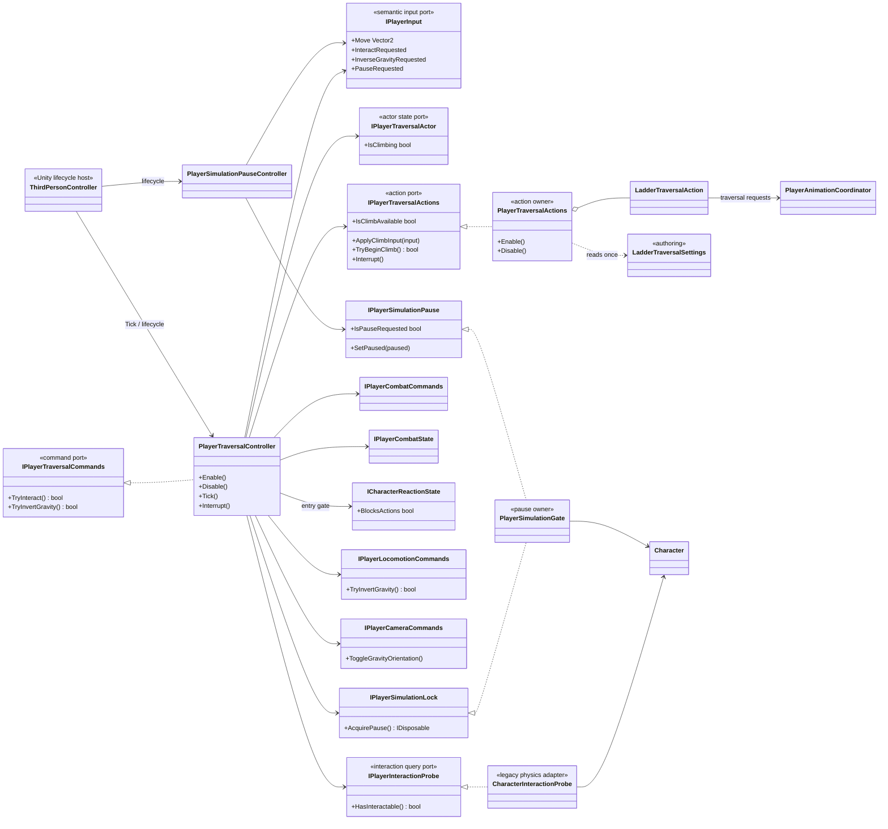
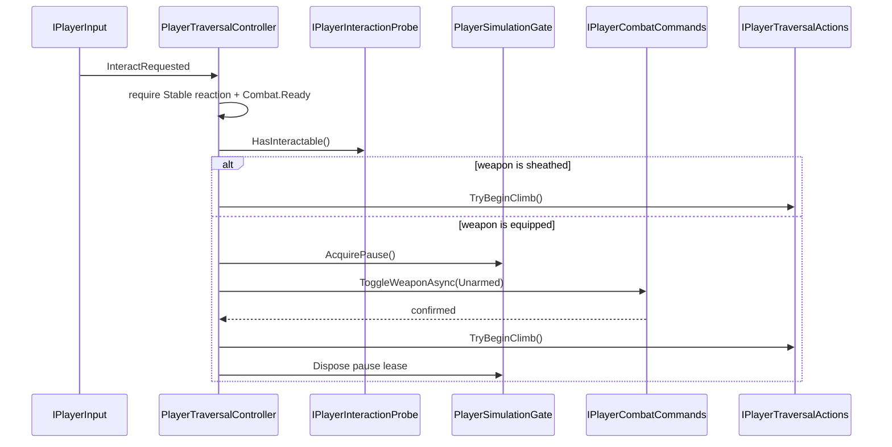

# Project S — Player Traversal

## Ответственность

`PlayerTraversalController` владеет application flow перемещений вне базовой locomotion state machine: взаимодействием с лестницей, передачей climb input, снятием оружия перед входом на лестницу и согласованным разворотом gravity/camera orientation. Начало traversal разрешено только в `Combat.Ready` и при стабильной reaction state. Он не читает Unity devices, не выполняет movement simulation и не управляет Cinemachine или Animator напрямую.

Локальная команда Pause вынесена в `PlayerSimulationPauseController`. Это пауза только симуляции `Character`, а не глобальная пауза игры, UI или времени. Такое название намеренно не обещает будущую pause-menu архитектуру.

## Дерево классов

## Interaction flow

Повторный Interact во время sheathe блокируется владельцем workflow. Reaction interruption инвалидирует ожидающую sheathe-операцию, освобождает pause lease, отменяет ladder UniTask и восстанавливает movement mode/constraints. После этого создаётся новый lifecycle token, поэтому traversal остаётся доступным после возврата reaction в `Stable`. Disable выполняет тот же cleanup без повторного запуска lifecycle; завершившийся позже async continuation не запускает climb и не меняет состояние нового lifecycle.

`CharacterInteractionProbe` сохраняет текущую физическую семантику: `CharacterMovement.OverlapTest`, первый collider и `IInteractable`. Это legacy adapter, а не стабильная универсальная interaction system. Layer mask и выбор лучшего кандидата должны стать отдельной authoring policy только вместе с реальными типами взаимодействий.

`PlayerTraversalController` делегирует конкретную механику в `IPlayerTraversalActions`. `PlayerTraversalActions` создаёт и владеет `LadderTraversalAction`, читая `LadderTraversalSettings` один раз при composition. Общего ability runtime и lookup по concrete type нет. `Interrupt` и `Disable` отменяют активные async ladder operations; отменённый step освобождает только собственный token и не может уничтожить token новой операции.

## Simulation pause ownership

`PlayerSimulationGate` — единственная новая точка, которая вызывает `Character.Pause` в player flow. Постоянный пользовательский pause request и временные locks хранятся раздельно:

- `PlayerSimulationPauseController` меняет persistent request;
- traversal получает disposable lease на время sheathe;
- фактическая симуляция возобновляется только когда request снят и все leases освобождены.

При обычном `Disable` pause controller снимает persistent request до разрушения Unity-компонентов, а traversal освобождает свои leases. `PlayerSimulationGate.Dispose` только инвалидирует scoped state и не вызывает `Character.Pause`: к моменту container teardown Unity уже может уничтожить `CharacterMovement`.

Это предотвращает ситуацию, когда завершение traversal случайно снимает паузу, установленную другим владельцем. Глобальный pause menu в будущем должен иметь отдельный owner времени и action maps; текущий gate не следует расширять до глобального service locator.

## Gravity inversion

Traversal вызывает `IPlayerLocomotionCommands.TryInvertGravity`. Только после подтверждения motor он отправляет `ToggleGravityOrientation` через camera command port. Camera и locomotion не получают concrete-ссылки друг на друга, а orientation presentation не расходится с gameplay gravity при отклонённой команде.

## ThirdPersonController и lifecycle

`ThirdPersonController` теперь содержит serialized authoring references, порядок `Enable/Disable`, frame ticks и compatibility entry point `InverseGravity`. Он больше не:

- подписывается на Interact/Pause/InverseGravity input;
- выполняет physics interaction query;
- знает о `Character` и climbing state;
- владеет async sheathe-and-climb workflow;
- соединяет `PhysicsVolumeChanged` с animation напрямую.

Последняя связь вынесена в `PlayerPhysicsVolumeAnimationAdapter`, который симметрично подписывается и отписывается вместе с lifecycle host.

`PlayerTraversalComposition` регистрирует probe, traversal controller, pause controller и один scoped `PlayerSimulationGate`. Scene/prefab wiring не требуется.

## Геометрия лестницы

`Ladder` описывает рейки в системе координат самой лестницы: `_firstRungOffset` — центр
первой рейки, `_rungSpacing` — шаг, `_rungHalfWidth` — половина её длины; все три
величины локальные и умножаются на `lossyScale`. Раньше начало отсчёта брали от
`BottomAnchorPoint`, то есть от точки, где стоит таз персонажа, а она вынесена вперёд от
плоскости перекладин на длину вытянутой руки — на `Ladder_01` это `0.205` м. Из-за этого
`NearestRungPoint` возвращал точку в `0.205` м позади настоящей перекладины, и IK тянул
кисти внутрь лестницы. Половину ширины тоже читали в мировых единицах, а умножали на
масштаб `0.4`, поэтому кисти сводило к осевой линии на `0.11` м.

Эталон — `Ladder_01`: рейки через `0.26` м при масштабе `0.4`, первая на `0.223` м,
перекладина длиной `0.36` м. Клип поднимает конечности ровно на `0.52` м, значит цикл
кроет две рейки без остатка.

`LadderTraversalSettings.AscendCycleRise` хранит именно авторскую высоту цикла — то, на
сколько клип поднимает руки и ноги за один проход. Это измеримое свойство ассета, а не
подобранное число: конечности в `Ladder_Ascend_Loop` проходят `0.522` м каждая.

`ResolveStepHeight` округляет её до целого числа реек, а `ResolvePathLength` округляет
высоту лестницы до целого числа таких шагов. Это даёт главное свойство подъёма: дорога
от нижнего якоря до верхнего — ровно `8` циклов клипа, поэтому в момент выхода наверху
цикл всегда стоит на фазе `0`.

Все лестницы сцены — экземпляры `Ladder_01`. Прежние `Ladder_02` и `Ladder_03` были
наклонными, с шагом `0.773` и `0.725` м, и под текущий набор клипов не годились.

## Непрерывный подъём

Раньше каждое нажатие «вверх» запускало отдельный `Step`: `CrossFade` в `Ladder_Ascend`,
линейное смещение на шаг, возврат в `Ladder_Idle`. Клип при этом рестартовал с нулевой
фазы каждый цикл, а в аниматоре у `Ladder_Ascend` и `Ladder_Descend` висел выход в
`Ladder_Idle` по `exitTime 0.99`. На каждом цикле получалось два блендинга подряд, и тело
успевало «осесть» и дёрнуться обратно.

Теперь состояние подъёма включается один раз и крутится, пока игрок держит направление;
выходы в `Ladder_Idle` из обоих loop-состояний удалены. `LadderTraversalAction` держит
темп `_climbRate`, плавно разгоняя и тормозя его за `ClimbRateBlendSeconds`, отдаёт его
в `SpeedMultiplier` и тем же темпом интегрирует пройденные циклы. Позиция выводится из
числа циклов, а не из времени, поэтому фаза клипа и высота персонажа заперты друг на
друга: замер подъёма на `Ladder_01` даёт совпадение `normalizedTime` и
`(y - anchorY) / 0.52` до третьего знака на всей дистанции, включая паузы.

Отпущенный стик не переключает состояние: `_climbRate` уходит в ноль, клип замирает на
текущей фазе, и вместе с ним замирает позиция. Позы `Ladder_Idle` в лазании больше нет
вовсе — слот остаётся замаплен, но не выбирается. Причина замерена: по major bones поза
`Ladder_Idle` расходится с `Ladder_Ascend` минимум на `34.8°` (в фазе `0.78`) и на `65.9°`
в фазе `0`, тогда как остальное семейство сходится вокруг фазы `0` подъёма — конец
`Ladder_Enter_Bottom` даёт `28.8°`, конец `Trav_Ladder_EnterTop_B` — `23.6°`, начало
`Ladder_Exit_Bottom` — `28.8°`, а начало `Ladder_Exit_Top` совпадает с ней ровно, `0.0°`.
Поэтому канонической позой захвата взята фаза `0` цикла подъёма, а не отдельный idle.

`PlayerTraversalController.Tick` теперь зовёт `ApplyClimbInput` каждый кадр, пока
персонаж лезет. Прежний порог по величине стика означал, что на нулевом вводе действие
вообще не получало тика, то есть не могло ни затормозить, ни остановить клип.

## Выход наверху

`Ladder_Exit_Top` — единственный клип семейства, который несёт собственный рут-моушен:
за 1.833 с он поднимает персонажа на `0.786` м и выносит вперёд на `0.411` м. Форма
движения нелинейная: вертикаль набирается рывками до `nt 0.58` и дальше стоит на месте,
горизонталь трогается только с `nt 0.20` и идёт до самого конца.

Прежний код вёл персонажа двумя линейными отрезками — сначала весь подъём за `35/55`
клипа, потом весь вынос за `15/55`. Отсюда и брались претензии к выходу: на стыке
отрезков скорость меняла направление на прямой угол, по вертикали персонаж уезжал
вперёд авторской кривой до `8` см, по горизонтали отставал до `15` см, и всё это время
ступни скользили по перекладинам.

Теперь `FollowExitTopProfile` ведёт трансформ по двум нормированным кривым из
`LadderTraversalSettings` — доля подъёма и доля выноса от нормированного времени клипа.
Кривые сняты с самого клипа как разница между позой с запечённым рут-моушеном и позой
в runtime, где `applyRootMotion` выключен и рут из позы вычтен; по 17 и 21 ключу они
воспроизводят замер до миллиметра. Дистанция берётся из геометрии (`от верхнего якоря
до TopPoint`), то есть кривая задаёт только форму, а лестница — масштаб.

Метод снятия стоит записать, он неочевиден. `AnimationClip.SampleAnimation` в редакторе
кладёт рут-моушен обратно в позу, а runtime с `applyRootMotion = false` его убирает.
Разность двух замеров одного и того же кадра и есть авторское смещение рута. Проверять
надо на одном и том же объекте и в одной системе координат: `InverseTransformPoint` на
`CharacterVisual` даёт значения в `2` раза больше мировых, потому что у объекта
`lossyScale 0.5`.

Оставшиеся клипы измерены там же: `Ladder_Enter_Bottom`, `Ladder_Exit_Bottom` и
`Trav_Ladder_EnterTop_B` рут-моушена не несут вовсе, их перемещение остаётся на коде.

## Хват за рейки

`LadderGripIkAdapter` висит на объекте с `Animator` и работает только в `OnAnimatorIK`
базового слоя, у которого IK pass уже включён. Состояние он читает через порт
`IPlayerLadderGrip`, который реализует `PlayerTraversalActions`; собственной игровой
логики у адаптера нет.

Адаптер различает опорную и переносимую конечность по её собственной скорости. Пока
скорость ниже `_plantSpeed`, конечность считается стоящей на рейке: цель защёлкивается
один раз и держится, вес плавно набирается. Как только конечность пошла — цель
сбрасывается, вес уходит в ноль, и клип ведёт руку сам. Без этого IK каждый кадр брал
`NearestRungPoint` от текущего положения, и в середине переноса цель перескакивала на
следующую перекладину: замер давал скачок кисти на `0.25` м за один кадр дважды за цикл.

Три правила делают обе границы непрерывными:

- защёлкивается только конечность, которая реально рядом с перекладиной — дальше
  `_latchDistance` цель не берётся вовсе;
- поправка считается, пока конечность стоит, и замораживается в момент отрыва, поэтому
  при сходе веса рука идёт строго по клипу плюс убывающее смещение, а не тянется к
  устаревшей цели;
- перезахват запрещён, пока вес не сошёл в ноль. Без этого конечность успевала
  перецепиться посреди отпускания: скорость колебалась около порога, цель бралась
  заново в `0.12` м от текущего положения, и кисть прыгала на `6` см за кадр.

Хват держится и во время выхода: `IsGripActive` покрывает состояние `Releasing`, иначе
руки отпускали лестницу в первом же кадре выхода, хотя по клипу они держатся почти до
середины. Отпускает их теперь сам детектор опоры, когда рука пошла.

Замеры на подъёме (`Ladder_02`, 2474 кадра с опорной кистью): отклонение кисти от рейки
`0.0015` м в среднем при пике `0.059` м, `2473` кадра из `2474` — меньше сантиметра.
Максимальное смещение кисти за кадр на подъёме упало с `0.253` м до `0.026` м, на
выходе наверху — с `0.063` м до `0.024` м, и оставшийся пик приходится на один кадр
переноса стопы на площадку, то есть на сам клип, а не на IK.

## Ladder presentation binding

`LadderTraversalAction` играет восемь слотов: вход сверху спереди и сзади, вход снизу,
idle, подъём, спуск, выход сверху и снизу. Они замаплены в `PlayerAnimatorActions` на
действие `LadderTraversal` с вариантами 0..7, а `XControllerAnimationContract.TraversalStatePaths`
задаёт соответствующие состояния `Base Layer.Ladder.*`. Длительности клипов авторятся в
`LadderTraversalSettings` и передаются в `CrossFade` как duration override — константы
длин в коде не хранятся. Кроссфейд ladder-слотов вынесен из `DodgeCrossFadeSeconds` в
свой `LadderCrossFadeSeconds` — `0.18` с вместо `0.10`.

`SetPlaybackSpeed` в `XControllerCharacterAnimationDriver` больше не трогает
`Animator.speed`, а только пишет параметр `SpeedMultiplier`. Раньше темп применялся
дважды — и глобально, и через параметр состояния, — поэтому спринт по лестнице шёл не в
`1.5`, а в `2.25` раза быстрее; заодно остановка темпа замораживала весь аниматор, а не
только лестничные состояния. `SpeedMultiplier` читают только `Ladder_Ascend` и
`Ladder_Descend`, так что других потребителей у этой правки нет.

Вход сверху использует только слот `LadderEnterTopBack`. Второй клип семейства
разворачивает тело на 197° и заканчивается с тазом в 179° от позы захвата, то есть не
стыкуется с лазанием ни при каком довороте трансформа; прежний код доворачивал трансформ
ещё на 180° поверх этого, и разворот применялся дважды. Направление подхода теперь
отрабатывается на фазе подхода: `ApproachLadder` доводит персонажа до якоря и в
каноническую ориентацию лестницы за время, пропорциональное и дистанции, и углу
разворота (`ApproachSpeed`, `ApproachTurnSpeed`). Слот `LadderEnterTopFront` остаётся
замаплен, но не выбирается — он ждёт корректного клипа с разворотом.

`CanClimb` отказывает, если хотя бы один из восьми слотов не поддерживается бэкендом,
и один раз пишет предупреждение. Это защита: лазание захватывает movement mode,
rotation mode и ground constraint с первого кадра, поэтому отсутствующая презентация
должна отклонить действие до захвата, а не посреди него. Любая иная ошибка внутри
climb-потоков возвращает состояние через `AbortClimb`.

Проверено в play mode целиком. Снизу: подход разворачивает персонажа и ставит на нижний
якорь, `Ladder_Enter_Bottom` переводит в позу захвата, подъём идёт одним непрерывным
`Ladder_Ascend` без единого рестарта состояния, пауза посреди подъёма замораживает и позу
и позицию, по достижении верхнего якоря запускается `Ladder_Exit_Top` и персонаж выходит
на площадку в `MovementMode.Walking`. Сверху: подход к `TopPoint`, `Ladder_Enter_Top_Back`
сажает на верхний якорь с нулевым доворотом, спуск проходит ровно восемь циклов
`Ladder_Descend` и заканчивается `Ladder_Exit_Bottom` на земле. EditMode: 93/93.

Замечание по методике: Unity не крутит игровой цикл, когда окно редактора не в
фокусе. При проверке traversal из внешнего инструмента нужно выставлять
`Application.runInBackground = true`, иначе последовательность выглядит зависшей,
хотя дело только в остановленных кадрах.

Второе замечание: метрика «расстояние до ближайшей рейки» алиасится. Шаг реек на
`Ladder_01` — `0.26` м, а цикл клипа — `0.52` м, поэтому ошибка ровно в один цикл
выглядит как ноль. Проверять надо ещё и покадровое смещение конечности, иначе
систематический сдвиг на целое число реек метрика не покажет.
