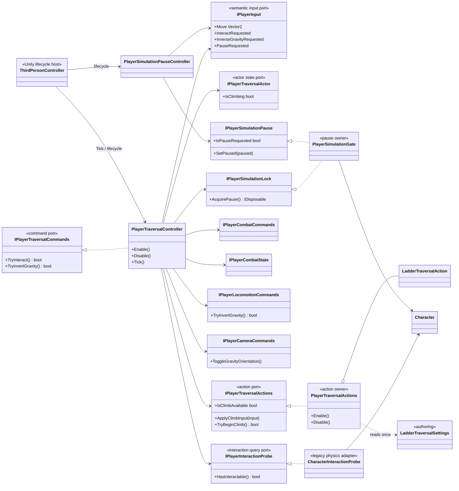
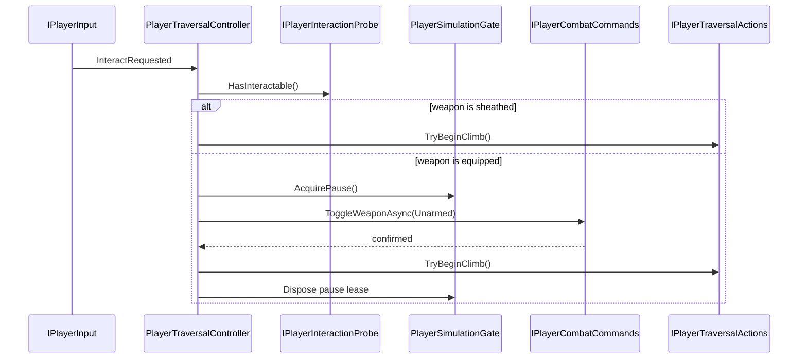

# Project S — Player Traversal

## Ответственность

`PlayerTraversalController` владеет application flow перемещений вне базовой locomotion state machine: взаимодействием с лестницей, передачей climb input, снятием оружия перед входом на лестницу и согласованным разворотом gravity/camera orientation. Он не читает Unity devices, не выполняет movement simulation и не управляет Cinemachine или Animator напрямую.

Локальная команда Pause вынесена в `PlayerSimulationPauseController`. Это пауза только симуляции `Character`, а не глобальная пауза игры, UI или времени. Такое название намеренно не обещает будущую pause-menu архитектуру.

## Дерево классов

## Interaction flow

Повторный Interact во время sheathe блокируется владельцем workflow. Disable инвалидирует ожидающую операцию и освобождает pause lease; завершившийся позже async continuation не запускает climb и не меняет состояние нового lifecycle.

`CharacterInteractionProbe` сохраняет текущую физическую семантику: `CharacterMovement.OverlapTest`, первый collider и `IInteractable`. Это legacy adapter, а не стабильная универсальная interaction system. Layer mask и выбор лучшего кандидата должны стать отдельной authoring policy только вместе с реальными типами взаимодействий.

`PlayerTraversalController` зависит только от `IPlayerTraversalActions`. `PlayerTraversalActions` создаёт и владеет `LadderTraversalAction`, читая `LadderTraversalSettings` один раз при composition. Общего ability runtime и lookup по concrete type нет. `Disable` отменяет активные async ladder operations и восстанавливает movement mode/constraints.

## Simulation pause ownership

`PlayerSimulationGate` — единственная новая точка, которая вызывает `Character.Pause` в player flow. Постоянный пользовательский pause request и временные locks хранятся раздельно:

- `PlayerSimulationPauseController` меняет persistent request;
- traversal получает disposable lease на время sheathe;
- фактическая симуляция возобновляется только когда request снят и все leases освобождены.

При обычном `Disable` pause controller снимает persistent request до разрушения Unity-компонентов, а traversal освобождает свои leases. `PlayerSimulationGate.Dispose` только инвалидирует scoped state и не вызывает `Character.Pause`: к моменту container teardown Unity уже может уничтожить `CharacterMovement`.

Это предотвращает ситуацию, когда завершение traversal случайно снимает паузу, установленную другим владельцем. Глобальный pause menu в будущем должен иметь отдельный owner времени и action maps; текущий gate не следует расширять до глобального service locator.

## Gravity inversion

Traversal вызывает `IPlayerLocomotionCommands.TryInvertGravity`. Только после подтверждения motor он отправляет `ToggleGravityOrientation` через camera command port. Camera и locomotion не получают concrete-ссылки друг на друга, а orientation presentation не расходится с gameplay gravity при отклонённой команде.

## ThirdPersonController и lifecycle

`ThirdPersonController` теперь содержит serialized authoring references, порядок `Enable/Disable`, frame ticks и compatibility entry point `InverseGravity`. Он больше не:

- подписывается на Interact/Pause/InverseGravity input;
- выполняет physics interaction query;
- знает о `Character` и climbing state;
- владеет async sheathe-and-climb workflow;
- соединяет `PhysicsVolumeChanged` с animation напрямую.

Последняя связь вынесена в `PlayerPhysicsVolumeAnimationAdapter`, который симметрично подписывается и отписывается вместе с lifecycle host.

`PlayerTraversalComposition` регистрирует probe, traversal controller, pause controller и один scoped `PlayerSimulationGate`. Scene/prefab wiring не требуется.
